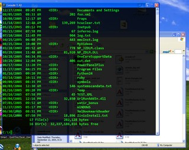

Nice, someone's gone and created the perfect pill for even the most serious case of Mac OS X Terminal envy...

  I give you: <a href="https://www.hanselman.com/blog/TransparentCommandPromptInWindows.aspx">Console2</a> !

[][1]

  It's got dang near everything I could ever want to configure... somebody really loves their command shells mmm hmmm 😛

  Only <em>little</em> nit pick I can come up with is that I think the Mac actually allows you to <strong>set the transparency of the just the background</strong>... so that the text and the outer frame still look crisp and solid.

 [1]: /images/uploads/2008/transparent-command-shell-windows-thumbnail.jpg