* [Update:  5 Apr 2012] Just popped for a [Samsung Galaxy Tab 7.7](/samsung-galaxy-tab-77-p6800/).
* [Update: 19 Aug 2009] Windows 7 totally rocks on this thing!!! At least as peppy as XP, probably better.   

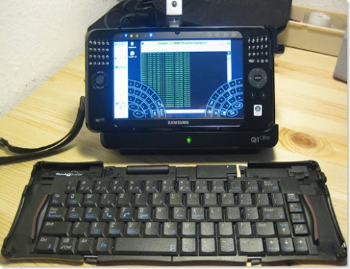

* Buy.com has some more good [photos](https://www.buy.com/prod/samsung-np-q1u-600-q1-ultra-umpc-elxp-a100-600mhz-1gb-40gb-7-wsvga-wl/q/loc/101/204996604.html), **AT THE BOTTOM**
* [some of my own photos](https://get.google.com/albumarchive/108669953529091704409/album/AF1QipPFAZbdBPj96dw954gd17_-P9iBBRoeu5XM-2XB)
* [Samsung's Q1U landing page](https://www.samsung.com/us/consumer/subtype/subtype.do?group=computersperipherals&type=mobilecomputing&subtype=ultramobilepcs)
  * (Interesting, they _just_ (Sept. 19th, 2008) withdrew their links for the Vista model that I got –for obvious reasons– looks like the new "Premium" model with a beefier CPU is the currently promoted Vista solution)

[Samsung Software & Drivers Page](https://www.samsung.com/us/consumer/detail/support.do?group=computersperipherals&type=mobilecomputing&subtype=ultramobilepcs&model_nm=NP-Q1U&language=&cate_type=all&dType=D&mType=DR&vType=&prd_ia_cd=05010100&disp_nm=Q1U-XP&model_cd=NP-Q1U/000/SEA&menu=download)

Specs on the model I got: 

| Spec | Notes |
| --- | --- |
| Model | Samsung Q1U-V (NP-Q1UA000) ([official spec PDF](https://www.samsung.com/us/system/consumer/product/2008/04/29/np_q1ua000sea/Q1Ultra_DataSheet_080907.pdf)) |
| Weight | 1.52 lbs |
| Display | 7" 1024 x 600 touch screen LCD (nicely bright) |
| Standard Battery | 4-cell Li-Ion Battery, 29.6wh Capacity (rated ~4.5 hours) (6 cells available) |
| OS | Windows 7 absolutely rocks on this thing!!! |
| Dimensions | 8.96" x 4.88" x 0.93" (think of a letter size sheet of paper, portrait orientation, folded in half, top to bottom) |
| HD | 60GB 1.8 4200rpm PATA ZIF ([Toshiba MK6008GAH](https://sdd.toshiba.com/main.aspx?Path=StorageSolutions/1.8-inchHardDiskDrives/MK6008GAH)) |
| WiFi | 802.11 b/g ([Atheros AR5006X specs](https://www.atheros.com/pt/AR5006XS.htm), [drivers](https://www.x-drivers.com/catalog/drivers/wireless_networks/companies/atheros/models/ar5001x/12162.html)) |
| Wired Ethernet | 10/100 Base TX |
| Bluetooth | Bluetooth 2.0 + EDR |
| USB | 2 x USB 2.0 |
| CPU | Intel Ultra Mobile A110 800MHz clock 512Kb L2 cache/400 MHz FSB |
| Video Chipset | Intel GMA950, 128MB shared memory ([specs](https://www.intel.com/products/chipsets/gma950/index.htm)) |
| System Memory | 1GB DDR2 400MHz stock (upgraded to 2GB) |
| Memory slot | SD/MMC |
| Audio | HD Audio, SRS TruSurround Sound |
| Cameras | Front facing low res web cam & rear facing video & still (1.3MP) |
| Speakers | 2 x 1.5 Watts |
| VGA 15 pin out | Max resolution 2048 x 1536 (nice) |
| Headphone out | Yes |
| Microphone | Dual Array |
| RJ45 (LAN) | YES |
| Warranty | 1 Year Parts and Labor |
| Fingerprint Reader | NO |
 
Update [29 Oct 2008]: Unfortunately my touch screen went all whacky, _exactly_ like I've read about:

  * A Samsung rep (apparently) even fesses up to a bad batch of screens: [Q1 Ultra Screen Issues](https://origamiproject.com/forums/2/25383/ShowThread.aspx)
  * [Problem with screen in Q1 Ultras](https://origamiproject.com/forums/1/24846/ShowThread.aspx)
  * Mine went bad on me while I was using it quietly on my desk... tried everything suggested with calibration tools... small improvements but nothing usable 
  * Could've been due to cramming it in a tight backpack through airport few days prior so I'll be a little more delicate with the new one 
  * Servicing seems to be very speedy, turnaround is days not weeks... waiting for it now... will advise 

Update [12 Nov 2008]: Servicing totally fixed the touch screen tracking problem.

  * They even went ahead and loaded the Samsung XP image rather than bothering with Vista 
  * And swapped out the "Designed for Windows \___" sticker, nice touch. 
  * Turnaround time was excellent. 
  * It is definitely a new screen, old one had a telltale scratch on it ... very nice to ditch that in the process. 

Highlights:

  * I was a little surprised to realize the Q1U-"V" does NOT have the fingerprint reader ([official spec sheet from Samsung][2] breaks down the differences pretty well if you look closely) ... kindof a bummer from a lost/security standpoint but fortunately this isn't really where I plan to leave any "life data" anyway 
  * Stock 4-cell, ~4.5 hr battery seems to get right to that mark if you're not doing WiFi... I've since ordered 2 of the 6-cells so I can roll through a big/hike w/o concern 
  * Going in/out of sleep mode is very instantaneous 
  * Vista just kept going off into wait cursor lala land too often so I flipped it over to XP Tablet after a couple days of usage just like everybody else 
  * You definitely wind up waiting on Vista for everything... as an IT guy it amazes me it ran as well as it did in 1GB of RAM on such a small CPU... I can't imagine an average consumer actually putting up with this configuration though 
  * Power slider switch doubles as full system input lock so you can't accidentally bump anything while it's on ... very cool usability feature that goes to show Samsung engineers put some real usage design thought into this bugger 
  * Watching a typical AVI movie over WiFi via VLC works like a champ under XP... Vista could barely pull it off. 
  * The screen is great ... super bright... you can see all normal Windows widgets at the native 1024 x 600 resolution ... you definitely need the stylus to hit normal sized Windows widgets (min/max/close, scroll bar, etc.)... fingers work for bigger stuff or widgets not next to another ... the Microsoft "Touch Pack" has a "Touch Improvements" tweak that makes the scroll bars double wide so you have a chance at hitting them with a finger... that's a nice "touch" ;) 
  * It does have a little heat to exhaust... nothing like a laptop of course... there's actually a little fan in there... but it's absolutely silent 
  * Last but not least, it fits very well as an eReader: 
      * 1.5lbs is very doable… holding it up to read from the lying down position definitely works 
      * Adobe Reader has some nice features I never realized.. it'll rotate the page so that rather than rotating the whole Windows Vista desktop (which is way slow) I can just rotate the document in Reader so that portrait viewing utilizes the longest dimension, awesome! 
      * You can also flip Reader into full screen mode to get rid off all scroll/nav bars/buttons and take advantage of full real-estate... 
      * a test Macworld PDF was fairly readable a full page at a time... shrinking an 8.5 x 11 inch page of text down by at least 50% while technically readable, would probably cause eye strain after prolonged reading at that size... 
      * what works quite well is to zoom in to 125% and simply use a finger to drag the page into view as one reads... it's very usable and intuitive this way 
      * I am VERY glad I didn't cave in for a cheaper unit in the popular 4"-5" screen size category (Nokia n810, e . this is absolutely the smallest you could work with for reading full pages... and honestly, a little bigger (9"??) would not go to waste.                   

## Background

These units have been out since late 2006 in various models, so there's a nice amount of solid info out there. The reviews from a year ago, when it was nearly twice the price, were a little more scathing. It's a tricky product genre to review because people's expectations are all over the board in this new niche. If you read between the lines and focus on what you want, they stack up pretty darn good. Everybody immediately recognizes that Vista is too much for these baby CPUs, and just like everybody else, I dropped back to XP Tablet and it runs great. Don't forget to load up XPLite and trim it all down to the bare minimum.

I see basically ~~three~~ four generations out there:

1. 1st gen = the original Q1 (distinguished by no keyboard on the side panels), basically old enough to scare me away.
2. 2nd gen = Q1U (U = Ultra), which is what I'm most interested in. It comes in several configurations. The biggest difference is that the cheapest "EL" model does NOT have the Bluetooth, camera, or SD slot that all the others do. Otherwise, the others vary by presence of fingerprint reader and hard drive size (40/60/80 GB).
3. 3rd gen = Q1U-P (Ultra Premium), significantly more expensive but comes with the most hardware pre-loaded (faster CPU, 2GB RAM, an easy upgrade for the Q1U, a high-speed cellular card, also a doable upgrade for the previous model, etc.). A year has now passed and I'm seeing refurbished Premium models going for the $700 range.
4. 4th gen = Q1EX-71G. This seems to have come out Q3/4 2009: 1.2GHz Via Nano U2500 CPU, 2GB RAM stock, SiRF Star GPS (missing from shipping models!?!), and no keys. [It was $522 on Amazon on 07 Sep 2010](https://www.amazon.com/s/ref=nb_sb_noss?url=search-alias%3Daps&field-keywords=samsung+q1ex&x=0&y=0). Damn, doesn't look like the GPS made it into production units. And it looks like they changed the dang battery form factor (different SKUs).

## Notable Accessories

### RAM-Mounts handlebar mount

[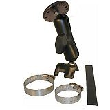](https://www.gpscity.com/ram-mount-strap-rail-base-with-standard-arm-round-assembly.html)

[RAM Mounts](https://www.ram-mount.com/mount/samsung_q1_ultra_mount.htm) is mounting nirvana: all kinds of mounting parts to perch this tablet on a ball pivot above bicycle handlebars, etc. Both of these RAM-Mounts parts are absolutely top notch. I ABSOLUTELY LOVE HOW THESE STAND UP TO REAL BANGING ON THE ROAD.

### RAM-Mounts custom cradle

[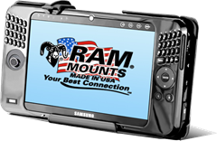](https://www.gpscity.com/ram-mount-samsung-q1-ultra-umpc-cradle.html)

[GPSCity](https://www.gpscity.com) has been very good with solid inventory, fast shipment and competitive prices on the whole RAM production line. They have a nice body of customer reviews to get a good feel for how most parts stand up in real usage. Make sure to search for shopping cart discount codes. This one gave me 10% off: RAMGUF5285.

### MicroSD card readers

[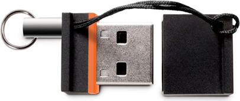](https://www.amazon.com/gp/product/B004BLIMOU/ref=pd_lpo_k2_dp_sr_2?pf_rd_p=1278548962&pf_rd_s=lpo-top-stripe-1&pf_rd_t=201&pf_rd_i=B0041O200O&pf_rd_m=ATVPDKIKX0DER&pf_rd_r=11TDP6DKDC7P7RMTSEKN)

These are a great development for us tableteers: basically nano-sized USB dongles that take a micro SD card into them and present very little profile to get whacked around on a mobile device where you need some more easy space.

### Sierra Wireless MC8781 HSDPA/3G cell modem + GPS

[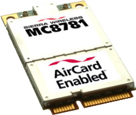](https://shop.ebay.com/?_nkw=SIERRA+MC8781)

Going after one of these now…

- **UPDATE [09 Sep 2009]:** My GPS experience has been a bust so far on this one. Make sure you have specific antennas nailed down. I got the small U-shaped one first. It got HSPA bars outdoors (Vodafone Germany) but nothing on GPS. Picked up two more designed for a unit with more internal room. They worked well and even got signal indoors when the giant antenna was just lying in open air, but destroyed the GPS signal improvement while cramming it inside. I'd recommend getting one of the external USB sticks that have this same chip; then the antenna comes along for free.
- [Model family specs comparison](https://www.sierrawireless.com/product/em_comparison.aspx)
- I'm thinking that "gpsOne" facility is worth going after.
- [Someone that installed the mc8775 model in the same exact tablet model as mine](https://himax60.blogspot.com/2008/01/my-q1u-gets-hsdpa.html)
- [Firmware and instructions for activating the GPS functionality](https://forums.whirlpool.net.au/forum-replies-archive.cfm/1108594.html)
- [Good installed pics](https://www.kaskus.us/showthread.php?s=9a4b2b54b08499801a3906260362d4ee&t=1155572&page=12) at this forum

I've been using the external [Garmin 10x Bluetooth receiver](https://buy.garmin.com/shop/shop.do?pID=423) this whole year and it's served me well, but Bluetooth connections are annoyingly flaky sometimes and I'd love to lose the external fob finally.

[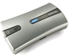](/images/uploads/2008/samsung-q1u-umpc-58245c1b2948.png)

### Super High Capacity Universal External Battery Pack BP150

[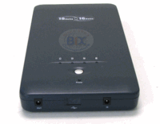](https://www.bixnet.com/unpowbat.html)

[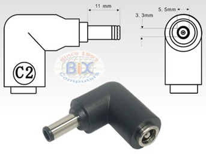](https://www.bixnet.com/unpowbat.html)

- Samsung stock AC charging brick DC-out = 19V, 3.15A.
- Samsung stock batteries are rated (both still available on eBay for around $40-$45 as of March 2011):
  - 4 Cell = 29.6Wh, 7.4V, 7800mAH (Product ID: AA-PL1UC4B)
  - 6 Cell = 57.7Wh (Product ID: AA-PL1UC6B)
- This BP150 is rated at 153 Watt-Hours.
- 3lbs is obviously something to consider: very doable for a bike, annoying for a backpack.
- At $200 this one is much more bang for the buck than [Samsung's external pack (AA-PL1UC8B)](https://www.samsung.com/us/consumer/detail/accessories.do?group=computersperipherals&type=mobilecomputing&subtype=ultramobilepcs&model_cd=NP-Q1U/000/SEA#), which I doubt is even manufactured anymore.
- [This is the exact spec on the DC-in power tip dimensions](https://www.bixnet.com/cntc2.html)… it does come with the BP150.
- [Cheaper ($120'ish) Toshiba unit with half the horses (74Wh)](https://www.buy-laptop-battery.org/external-universal-laptop-battery.htm) – Model#: EEXT001WO1.
- [BatteryGeeks.net](https://www.batterygeek.net/Batterygeek-15-21-130-External-Laptop-Battery-p/15-21-130_batterygeek.htm) has some awesome looking units, but they're pricey: $300 for 130Wh.

### Tekkeon myPower All

I have a buddy that got the ["Tekkeon myPower All" (Model#: MP3450) for $109 from NewEgg](https://www.newegg.com/Product/Product.aspx?Item=N82E16855997152&cm_re=tekkeon-_-55-997-152-_-Product). It's a nicely flexible 50Wh battery for multiple purposes, with 9 included adapter tips and selectable voltages: 5V, 6V, 7.5V, 9V, 12V, 14V, 16V, and 19V. Compare the three slightly different models MP3450 R2, MP3750 R2, MP3450i R2 ([comparison tables here](https://www.tekkeon.com/products-mypowerall.html) and [here](https://www.tekkeon.com/products-mypall-features.html)); differences are very subtle. MP3450 has most selectable voltages and a travel charger; MP3450i is a little more beefy/expensive.

[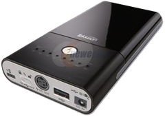](https://www.newegg.com/Product/Product.aspx?Item=N82E16855997152&cm_re=tekkeon-_-55-997-152-_-Product)

### AverMedia QuickPlay PC VGA to TV

[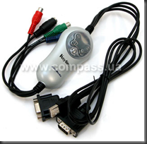](https://www.avermedia-usa.com/presentation/product_quickplay.asp)

Results vary wildly since it depends on which signal format you're able to use. Single composite video is not so hot, but "YPbPr" composite has turned out very crisp for me on a recent display. If you're ready to carry a bunch of cables and be happy that you have a connection at all, this unit is "ok" for [$70 street price](https://www.google.com/products/catalog?hl=en&q=avermedia+quickplay&cid=2525492441776978560&sa=button#scoring=p)… that's a little steep for what you get out of this, so don't go any higher.

### Bluetooth keyboard

Sierra model by ThinkOutside (discontinued).

[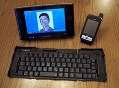](https://jkontherun.blogs.com/jkontherun/2006/09/thinkoutside_si.html)

[This BlueTooth keyboard is pretty nifty](https://jkontherun.blogs.com/jkontherun/2006/09/thinkoutside_si.html)... I actually managed to get my hands on one from eBay for $65. It looks like some idiots acquired that company and nixed the whole keyboard product line, so they're no longer manufactured. It does have a good feel and the case is slick.

Naturally something this small can't be very sturdy… I've already lost a screw due to a weak plastic screw hole, but it's holding together ok.

### Otter Box case

[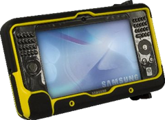](https://www.otterbox.com/samsung-q1u-p-defender-case)

This protective case by ["Otter Box"](https://www.otterbox.com/pc-tablet-umpc-cases/samsung-q1up-case/) looks pretty sweet in the ads, but after having it for a while I don't really recommend it. It's not a very polished product. I've logged a year's worth of hiking and biking miles on this Samsung now and I never take the Otter Box. Just get a couple screen protectors since that's really all that needs protecting.

I do wish RAM-Mounts made an "Aqua Box" that was large enough for a full waterproof solution ([Aqua Box mount](https://www.gpscity.com/aqua-box-mount)). They had to make it generic enough to handle a couple different units with different features. It winds up being a clumsy mix of rubber hole covers at various points around the main plastic case. The plastic part is two pieces that snap together around the tablet (front and back) with typical "pressure clips", two on top and two on bottom. Those clips held up just fine under the jostling of a hike; I'm kinda worried about wearing them down taking the tablet in and out between hikes.

The rubber feels hardy; it covers the back almost entirely. I wish the whole thing was made of that thick rubber and no plastic!

I'd say the biggest disappointment is the thick flexible clear plastic cover for the tablet screen and side buttons. It really isn't that good of a fit, which makes using those little keyboard buttons even tougher, so the onscreen "dialkeys" software keyboard is even more necessary. One bummer is that you can't leave the case on and still use the charging cradle. Taking it on and off isn't the speediest process. It comes with a hand strap that can be mounted on either left or right hand side with allen screw holes that might come in handy for other mounting scenarios. It does add about 12 ounces.

## Misc Links

- [Showing Ubuntu loaded up](https://www.tabletpcreview.com/default.asp?newsID=1070)
- [Cheapest vendor I've found](https://shop.vendio.com/malibu281/item/996351118/index.html) for the Q1U's
- [How to get the bugger open for upgrades (RAM, etc.)](https://ubertablet.blogspot.com/2007/06/how-to-upgrade-q1-ultra-to-2gb-ram.html)
- [jkontherun.blogs.com](https://jkontherun.blogs.com/) - tons of good hands-on mobile hardware info including the Samsungs

## Reviews

- [Mobile Tech Review](https://www.mobiletechreview.com/notebooks/Samsung-Q1-Ultra.htm)

## Nifty

- When it's just sitting there in its charging cradle, throw on Google Photo Screensaver and it doubles as one of those nifty wireless photo picture frame screens that are all the rage these days ;-)
- It's naturally a great mp3/avi player for planes, etc. Remember to take headset(s) and a Y-splitter if there's a better half in your equation.
- During trips, at end of day, it's nice to empty out one's digicam chip and review photos on the tablet's larger screen.

[1]: https://lh6.ggpht.com/_XlySlDLkdOc/SXYXrC3LnVI/AAAAAAAACrk/cblrtazebPM/s1600-h/Snap1%5B6%5D.jpg
[2]: https://www.samsung.com/us/system/consumer/product/2008/04/29/np_q1ua000sea/Q1Ultra_DataSheet_080907.pdf
