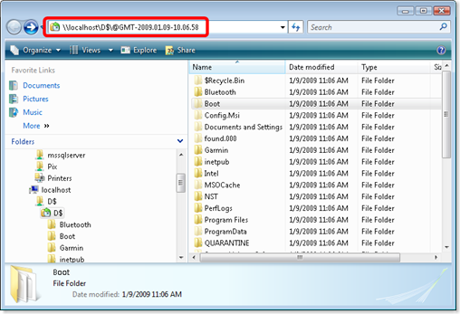
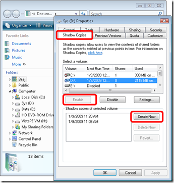

(at least in Windows 2008) More specifically the "Previous Versions" functionality that leverages this service. To cut to the chase, **I didn't realize that you could browse into whole folders worth of snapshots**... screenshot below says it all... Notice that there's a funky "localhostdrive$@GMT..." syntax for getting at the old version of that folder... in this case I shadowed the entire drive starting at the root level. After Googling around a little more on this I'm starting to think us Winblows users shouldn't be quite so OSX TimeWarp jealous and that VSS although not as sexy, is perhaps even more robust. In case you have no idea what I'm talking about this is a built in file level "snapshot" feature at the OS level... we get to recover the previous version of any file that's been snapshot this way... I'm not sure yet but I think one might be able to turn it on so that a snapshot automatically occurs whenever you modify a file. [][1] It's kinda tucked away ... you have to manually go and turn it on under the Properties of your drive letters: [][2] Here we can create snapshots manually of course. And you'll want to check out the snapshot schedule under Settings button which defaults to weekly... might wanna make that more often ;) One quickly realizes the best strategy is not to simply blindly shadow your whole drive but to define a frequent schedule on your documents and development type folders ... pick and choose like that depending on the specific content. The help is quick to point out its something to be used in tandem with normal backups and is not a replacement.

 [1]: /images/uploads/2009/volume-shadow-copy-service-is-pretty-afba734064f5.png
 [2]: /images/uploads/2009/volume-shadow-copy-service-is-pretty-01c433c80a15.png