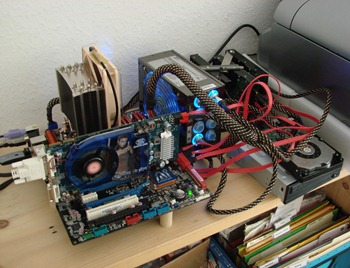
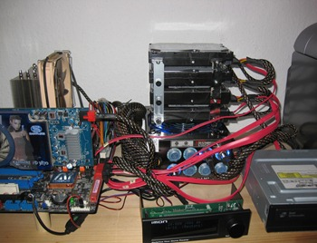
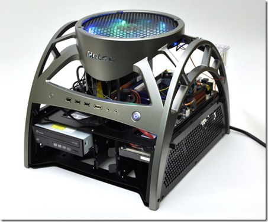
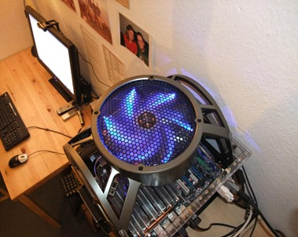

Update 2015-01-07: Replacing the HDD cage fan &#8211; mine got a bad case of the rattles 
      
*   Nutshell: [Silverstone FM83](https://www.google.com/search?q=fm83+fan)
*   92mm fan on 80mm mount holes = somewhat rare
*   Got one [Jan 2015 for $16 + $9 shipping from FrozenCPU](https://www.frozencpu.com/products/6144/fan-313/SilverStone_FM83_92mm_Case_Fan_in_80mm_Mounting_Frame_w_Fan_Controller.html)... there honestly doesn't seem to be much availability left out there in general
*   Looks to be manufac'd circa 2007 by the packaging... nothing stays around forever = get it now if you ever think you're going to want it
*   i've got a bunch of spare straight "square" 80mm fans... i'll probably just burn one of those "next time" even though the air flow won't be elegant.
*   it fits like a glove in the Skeleton's fan shroud... really tight fit but it does cram
*   i used the included grommets to secure the skeleton's fan grill to it's outer shroud via the stock screws since this new fan's casing is thinner and doesn't provide a point of contact for the screws... works great, very snug... totally silent all around
*   the speed control is a little overkill but kinda cool
*   those drives are 2 x 4TB in RAID1 for my primary backup storage so i tend to think a little TLC like this lifetime cooling is a worthwhile investment

      
### Before: Raw Parts on a Shelf ;) (circa April 2008)
      

        
### Antec Skeleton (installed Sunday 13 December 2009)

