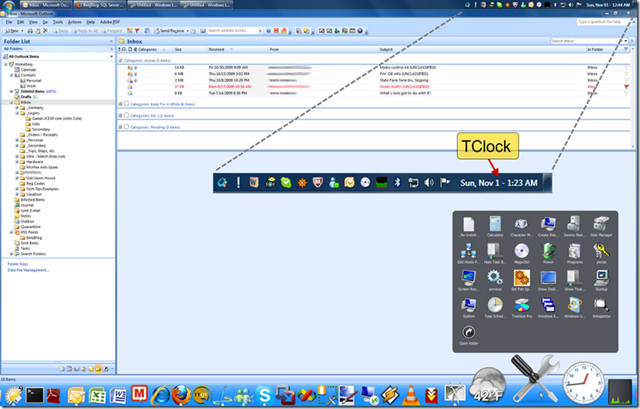

This should really be titled "Endlessly Searching For... The Perfect Desktop"... circa Windows 7, this is a reasonably satisfying mock of OS X's desktop:

# Dock
* Currently using StarDock's [ObjectDock](https://www.stardock.com/products/objectdock/) for the main OS X cool factor dock at the bottom... there's of course been others over the years, [WinStep](https://www.winstep.net/nexus.asp), [Rocket](https://rocketdock.com/), [XWDock](https://github.com/VolodymyrLykhonis/XWindows-Dock-2.0)... while grateful for their efforts in what must be an unrewarding niche, i always wind up wanting more :)

* [StacksDocklet](https://arshi2009.deviantart.com/art/Stack-Docklet-For-ObjectDock-103031280) by Arshi2009 is awesome for replicating the sexy OSX _stack_ effect… I'm using this to house my favorite little utilities & control panels. 

* Running a couple other native Docklets for Weather and Clock as well as 3rd party [CPU Usage](https://www.dockex.com/items/28) and [System Sleep](https://www.wincustomize.com/skins.aspx?skinid=2349&libid=29) (which is actually scrolled off the far right of the screenshot).

# Notification Icons
* After long searching for a way to reliably replicate all the Windows Notification Area functionality, I finally accepted simply running the standard Windows Taskbar at screen top is probably the most functional Mac approximation.

* StarDock's [ObjectBar](https://www.stardock.com/products/objectbar/) was pretty good but not perfect… there are several decent Mac skins, and it does replicate the Notification Area.  Unfortunately, for example, the volume icon did not work properly.  It would not pop up the volume slider window (which is apparently technically called a "[Thumbnail Toolbar](https://msdn.microsoft.com/en-us/library/aa511446.aspx#thumbnail)" in the Windows User Experience Guidelines). 

* I love that the built in native Windows volume slider popup responds to mouse wheel… very convenient for quick adjustments.

# Clock
* An old tool called [TClock](https://web.archive.org/web/20161031011736/https://homepage1.nifty.com/kazubon/tclocklight/) enabled the kind of tweaks I'm into, like **<u>showing the date</u>**.  Otherwise the minimized native Taskbar clock only displays time.  This little gem let's us configure several interesting properties like transparency. Definitely worth a look. 

# Demo Screenshot
