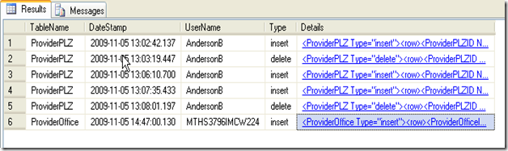
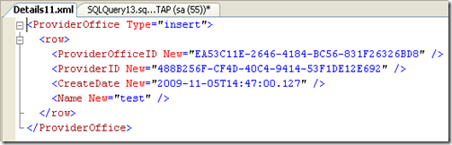

Feedback Update #1 [2009-11-15]:

  * Two different vectors of peer feedback highlight my myopia for sending all the audit data to a single table… and yes, why the heck i felt comfortable cramming disparate data into one table in the first place seems very bonehead :)  having mirror copies of each table where the audit data resides seems much more <a href="https://en.wikipedia.org/wiki/KISS_principle" target="_blank">KISS</a>… and i figure i better scramble my design in that direction before anybody really gets cranking on this new system 
  * Another point of feedback is SQL Server 2008's "<a href="https://www.zdnetasia.com/techguide/storage/0,39045058,62050506,00.htm" target="_blank">Change Data Control</a>" (CDC) facility… i wasn't actively tracking on this and it'll be great to head towards… the author even suggests that there is some support for this in SQL Server 2005… given the basic approach, coding something ourselves doesn't seem that tough… it's probably stuff like the built-in automatic schema change handling in 2008 that we'd be missing in 2005. 

Highlights/Assumptions/Considerations [2009-11-05]:

  * **SQL Server -** there's probably some SQL Server (2005) dependencies in here … As far as developer oriented databases go, I friggin LUUUV the way one can make SQL Server dance, especially as of version 2005… XML datatype, VARCHAR(max), .Net stored procs, funcs and aggregates… man this is the life!! 🙂 
  * **Stored Procedures** – i can't think of any reason why this approach would be stored proc dependent but if it is, i'm glad…  i love procs… i'm one of those guys that would really love to sit down with you (and a couple pints ;) and discuss the merits of coding business logic in stored procs… yep i said it… i'd even go so far to say that stored procs can be your true one and only business layer <gasp!! ;> 
  * **ADO.Net** – this writeup also sorta assumes that you're implementing in ADO.Net (because of the connection string specifics) 
  * **Custom Datalayer** – I've implemented this technique as a graft onto my existing custom datalayer (it's got one class, can you guess what it's called? ;)  That code is included below… it's very bare bones… which I think is a good thing, so that you can take and repurpose how you like. 
  * **SqlDataSource Compatibility** – after i got it all working i realized that i'd dabbled a little with using SqlDataSources in this project as well as my own custom datalayer… i'm happy to report it was a very quick mod to bring them into the program. 
  * **Single Standard PK Column Name** – i generally data model with a GUID PK on all my primary "business" entities and an INT PK on Code Tables… so my code takes advantage of knowing that there's going to be a column named {Table}ID on every table… the main place this plays in is joining INSERTED & DELETED together in the Audit_Triggers 
  * **** UserName Context** – logging the UserName that is performing a given data update to the Audit table is accomplished via a little trick i've been meaning to explore for quite some (and it seems to work! :)… given the usual web/database constraints i run into, it makes the most sense to have a single database login from the web app… therefore, establishing the UserName context is a bit of a challenge… the trick is to have your datalayer tack on the current username via the connection string parameter "Workstation ID"… and then retrieving it in T-SQL via the HOST_NAME() function… yep that's a bit of a hack :)  but for my purposes i think it fits ok… 
      * connection pooling was the first consideration that struck me… from what i understand, pooling is based on each unique connection string, so yes this probably negates the benefits of a larger shared pool of connections… this is something to keep in mind if you plan on having a lot of concurrent users firing auditable queries… 
      * one immediate optimization would be to make sure only update procs specify the Workstation ID so that all the read queries would run full bore on the whole pool. 
  * **Triggers** – i went ahead and based this approach on triggers… I've sorta grown up to despise triggers because they can trip you up just when you start to forget about them… one example is when you want to perform bulk data loads and really would prefer not to execute the trigger logic… in this case since the triggers are code gen'd i'll have an easy script to drop/re-create and I plan on wrapping that in an on/off proc to make it as convenient as possible… I'm just going to have to keep an eye on how annoying they get over time within the scope of maintaining the application where i've applied this technique… one mitigation would be to fall back to moving the audit logic directly into the update procs… in that case it still seems fairly straightforward to code gen an equivalent approach to triggers' "inserted/deleted" pseudo tables since i tend to code procs as either upserts or deletes which gives good context to tee off of. 
      * Audit\_Trigger\_CodeGen – once i got the T-SQL banged out of one trigger it was easy to turn it into a dyn-sql loop that generates the necessary triggers for all the tables in your database… that code is included below as well. 
  * **Changes only** – from reading the forums it seems like most folks are like me in that they're interested in seeing the changes specifically and not just a raw dump of all the old and new data where an update has been applied… most of the wonky responders say something like, "you should be logging all of it so you have it all for other purposes and then you can write a routine that displays only the changes"… ok yes, but then the person is still asking the same questions, where's the code/technique to filter out just the changes, because that's all i want to see right now… well, my code only logs the changes… i did that because i thought about it for 2 nanosecs and i didn't like the idea of writing something that would be scanning every row to show me what i really wanted… plus it does seem like this data could add up… yeah yeah, drives are cheap these days so we can all throw data storage considerations to the wind! right… but maybe your organization isn't standing at the ready, waiting to toss you some more drive space the moment you raise your hand. 
  * **Exceptions to the rule** – of course i quickly ran into a couple situations where a simple audit trigger just wasn't going to do the trick… in these exceptional cases it strikes me as very reasonable to exclude those particular tables from the Audit\_Trigger\_CodeGen and code the custom auditing directly into the update procs… you can log it all in the same Audit table so i think the approach still holds together nicely from a consistency standpoint. 
  * **Automatic Schema Change Awareness** – The HashBytes() T-SQL function is used to store the column signature that existed when the Audit\_Trigger\_CodeGen was last run … there's a little subroutine proc that checks to see whether this hash is the same and refreshes the table's trigger definition accordingly… if you're really worried about runaway columns then throw a call to this checker proc at the beginning of all your update procs … currently i'm just keeping this off to the side and running a refresh when i know i've added a new column so i don't have that nagging feeling that i'm zapping some nano-secs of performance for no good reason. 
  * So yes, lots of assumptions and caveats but not too shabby when it honestly came together in just 1.5 days of dedicated coding. 

Teaser screen shots: [][1] [][2] Code Attachments:

  * First off, i'm rolling with "Google Docs" here until i find something better, they don't support certain filetypes like .cs, so save-as accordingly 
  * Secondly, if Google Docs prompts you for a login and you don't feel like creating an account, just change the URL to HTTPS and refresh… after that it will create the appropriate cookie and HTTP links will work… yep it's a known bug 

  * <a href="https://docs.google.com/Doc?docid=0AS8Y50ZAhKVDZGN4Z3ZkbnRfM2M1NXAyd2Rk&hl=en" target="_blank">DataLayer.cs</a> – the greatest Proc class ever writen ;) 
  * <a href="https://docs.google.com/Doc?docid=0AS8Y50ZAhKVDZGN4Z3ZkbnRfN2Y4dDk5emc5&hl=en" target="_blank">ReflectionHelpers.cs</a> (referenced in DataLayer.cs so you'll want it) 
  * <a href="https://docs.google.com/Doc?docid=0AS8Y50ZAhKVDZGN4Z3ZkbnRfNWNnYmdqY2Rt&hl=en" target="_blank">Audit_Trigger_Checker.sql</a> – the HashBytes() stuff 
  * <a href="https://docs.google.com/Doc?docid=0AS8Y50ZAhKVDZGN4Z3ZkbnRfNHI4Z2RzcW43&hl=en" target="_blank">Audit_Trigger_CodeGen.sql</a> – here's the beef 
  * <a href="https://docs.google.com/Doc?docid=0AS8Y50ZAhKVDZGN4Z3ZkbnRfNmdtOXFjOWQ3&hl=en" target="_blank">SqlDataSource_snippet.cs.sql</a> – how to slap in SqlDataSources w/o much effort 
  * Audit Table:
  
    > CREATE TABLE \[Audit\](   
    >     \[TableName] [varchar\](50) NOT NULL,   
    >     \[DateStamp\] \[datetime\] NOT NULL,   
    >     \[UserName] [varchar\](50) NOT NULL,   
    >     \[Type] [varchar\](20) NULL,   
    >     \[Details\] \[xml\] NOT NULL   
    > ) 

  * Example Proc class call: 
    using (Proc Provider\_iu = new Proc("Provider\_iu", User.Identity.Name))   
    {   
      if (Provider_iu.ExecuteNonQuery(lblProviderMessage, false))   
      {   
        lbxProviders.Items.Add(new ListItem(Provider\_iu["@Name"].ToString(), Provider\_iu["@ProviderID"].ToString()));   
        lbxProviders.SelectedIndex = lbxProviders.Items.Count - 1;   
        lbxProviders_SelectedIndexChanged(null, null);   
      }   
    }

 [1]: /images/uploads/2009/yet-another-simple-audit-table-approac-b0dab635b9ba.png
 [2]: /images/uploads/2009/yet-another-simple-audit-table-approac-3496c4e08788.png