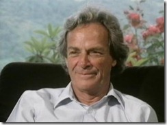

 Just kinda catching up with how "fun smart" this guy was… worked on the Manhattan project, all kinds of creative physics problem solving, "Original Prophet of Nanotechnology", Nobel prize in Physics 1965, liked strip clubs, art and bongo drums… there are at least two semi-auto biographies out there in public circulation… I'm reading "Surely You're Joking, Mr. Feynman!" right now… also a few enjoyable BBC Horizon videos featuring a fair amount of direct interview content: "<a href="https://docuwiki.net/index.php?title=The_Pleasure_of_Finding_Things_Out" target="_blank">The Pleasure of Finding Things Out (1981)</a>", "[The Quest for Tannu Tuva (1988)][1]" and "<a href="https://docuwiki.net/index.php?title=No_Ordinary_Genius_Richard_Feynman" target="_blank">No Ordinary Genius (1993)</a>"

 [1]: https://docuwiki.net/index.php?title=The_Quest_for_Tannu_Tuva "https://docuwiki.net/index.php?title=The_Quest_for_Tannu_Tuva"