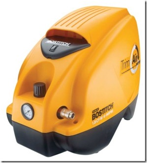
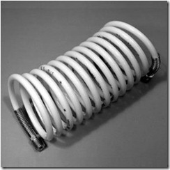
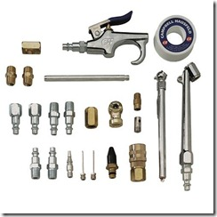
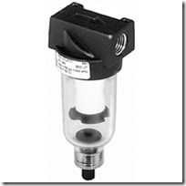

### Good References: 

* [ToolCritic.com handy sortable list](https://www.toolcritic.com/very-small-portable-compressors.html?sort=dgra) 
* [Amazon reviewer’s list](https://www.amazon.com/Portable-Compressor-Shopping/lm/R8RCNQ46DP8CK/ref=cm_lmt_dtpa_f_3_rdssss0?pf_rd_p=253466001&pf_rd_s=listmania-center&pf_rd_t=201&pf_rd_i=B000GZS6NC&pf_rd_m=ATVPDKIKX0DER&pf_rd_r=0SWDHZNHJBYAXKC72SSP) 

I found the Bostitch Model# CAP1516 to be an obvious choice based on features, price &amp; ratings.        

### Pros
* it gets consistently good reviews
* excellent price: [$80 street](https://www.amazon.com/Bostitch-CAP1516-2-Horsepower-1-6-Gallon-CAmper-Shaped/dp/B0009OAKIY/ref=sr_1_1?ie=UTF8&s=hi&qid=1263503619&sr=8-1)
* low end weight as far as these buggers go: 20lbs
* good air flow @ good psi: 1.8 CFM @ 90 PSI (6.2) bar which is plenty to blast your components with … it actually maxes at 120 PSI (8 bar)
* i like the protection the hood provides which is fairly unique if you look around
* the built in gauge and regulator are nice

### Cons
* no accessories included – however the 1/4” quick release is VERY standard and easily accessorized… and we don’t lose any extra cost on junky accessories
* challenging to mount water trap – unfortunately the protective hood wraps around the outie such that we can’t hang a typical trap right there (see trap photo below)… i am going to make due with mounting mine on the inside of the hood… there is a 1/4” threaded junction point with decent room to hang something right next to the air tank… the trap will take a while to fill up, you’ll know when it’s time when you see the water and the hood is easily removed… with a little work I might even widen a potential access hole on the undercarriage.

### Recommended accessories:    

*   [Hose](https://www.amazon.com/exec/obidos/tg/detail/-/B00066141C/ref=ord_cart_shr?_encoding=UTF8&m=A16WXXJJ7WJVS0&v=glance) - $13
*   [Attachments & Fittings](https://www.amazon.com/exec/obidos/tg/detail/-/B0009KN9PE/ref=ord_cart_shr?_encoding=UTF8&m=ATVPDKIKX0DER&v=glance) - $28
*   [Water Trap](https://www.amazon.com/exec/obidos/tg/detail/-/B000IKM09G/ref=ord_cart_shr?_encoding=UTF8&m=A2YLYLTN75J8LR&v=glance) - $20
*   ESPECIALLY IMPORTANT IF YOU PLAN ON HOSING DOWN DELICATE ELECTRONICS … it’s a well known fact that compressing air also compresses the humidity in the air … this ultimately results in spraying a fine mist of water all over your subject if not otherwise accounted for… honestly a little bit probably wouldn’t kill something immediately but it’s jut not the kind of thing you want to be subjecting your precious toys to on a regular basis

