### Misc Notes:

  * Given: iTunes has some pretty high quality cover art for many albums (all images are standard 600 x 600 pixels). 
  * The basic trick here is that you can sign up for a free iTunes account (without providing any credit card or other personal info)… 
  * And use that account to download the cover artwork for free. 
  * Then run my script which will automate iTunes to extract the cover from iTunes’ special stash and save it as a real local image file 
  * -AND- then embed that image back into the MP3 file so that it stays with the MP3 file no matter where it gets transferred. 
  * The iTunes API is clean, the .CHM based API document that comes with the SDK is easy to navigate and is readily understandable… this really opens a lot of possibility with some quick javascript. 
      * [Obtain the iTunes COM for Windows SDK here (you'll need an "Apple ID", it's free to sign up)](https://connect.apple.com/cgi-bin/WebObjects/MemberSite.woa/wo/5.1.17.2.1.3.3.1.0.1.1.0.3.3.3.3.1) 
      * To be clear, **you don’t need to download or install anything to use my script**… iTunes comes ready to be scripted out of the box. 
  * Note: if you’re experiencing the kind of trouble where the MP3 tag changes simply don’t take no matter what you do, try entirely wiping out the existing tags and start from scratch… for me, the “APE” metatag format always seemed to be a culprit (vs. “ID3” which is much more common) 
  * [MP3Tag][https://www.mp3tag.de/en/] is an excellent tool for bulk tag cleanup efforts like this… tons of good wizard driven actions you can perform on mp3 files names & tags… remove string, mixed case conversion, etc. 
  * [Standard list of iTunes genres](https://manufacturedenvironments.com/2008/04/organizing-itunes-simplify-your-genre-list/) for handy reference
  * Image size increasing MP3 size – if you’re trying to cram your music on a smart phone this could matter and I was asked about it.&#160; Taking a quick random sampling of my covers I saw from 50k to 80k per 600 x 600 pixel JPG artwork added to each file.&#160; Rounding up to 100k and assuming an average of 4MB’s per MP3 means for every 40 MP3’s you’re adding the size of an additional MP3 to your library.&#160; A 16GB SSD would hold ~4 thousand MP3’s… adding images would knock that down by ~100.

### Steps:

1.  Follow steps below to create free iTunes account… thus providing free artwork download capability
2.  in iTunes press CTRL-A to select all your tracks
    *   now ONLY IF YOU WANT TO REPLACE all your existing artwork with iTunes covers... with your entire library selected in iTunes, right mouse and select “Get Info”, and then check the box next to the blank cover image and hit OK, this will clear the artwork from all your MP3 files!  Make sure you save any of the ones you care to keep ahead of time. It will take quite a while to complete that wipe, of course depending on the size of your library.
3.  Right-mouse and select “Get Album Artwork” – this will download covers for every MP3 file that doesn’t already have artwork embedded in the file. `
4.  Now run my script from CMD.EXE
    1.  cscript EmbediTunesDLArtwork.js
    2.  I’ll be honest, a handful of albums always proved stubborn, the scripted image embedding simply wouldn’t take for no apparent reasons, no errors… just had to do those few by hand.
5.  That’s basically it, go have a look!

Enjoy!

##### EmbediTunesDLArtwork.js
```js
var tracks = WScript.CreateObject("iTunes.Application").LibraryPlaylist.Tracks;
var fso = WScript.CreateObject("Scripting.FileSystemObject");
WScript.Echo("Tracks to analyze: " + tracks.Count);
forEach(tracks, function (track)
{
  if (track.Kind == 1 && track.VideoKind == 0)
  {
    //"VideoKind: " + track.VideoKind + ", Kind: " + track.Kind + ", KindAsString: " + track.KindAsString +
    //"Index: " + track.Index + ", PlayOrderIndex : " + track.PlayOrderIndex +
    /* uncomment to collect missing artwork into a big group that's easily grouped together in the iTunes GUI by sorting on the "Show" column header
    if (track.Artwork.Count == 0)
    {
    track.Show = "!!missing artwork!!";
    WScript.Echo("Missing artwork – Artist: " + track.Artist + ", Album: " + track.Album + ", Name: " + track.Name);
    }
    continue;
    */
    //now for all downloaded artwork, save it to an image file and then write it back into the mp3 file so that we're free to carry music with artwork out of iTunes
    var AlbumFolderName = fso.GetParentFolderName(track.Location) + "";
    forEach(track.Artwork, function (art)
    {
      //debug:WScript.Echo("  IsDownloadedArtwork: " + art.IsDownloadedArtwork + ", Format: " + art.Format + ", Description: " + art.Description);
      var AlbumArtworkFullPath = AlbumFolderName + track.Album.replace(new RegExp("[:?$/@*]", "g"), ".") + ArtworkFormatAsString(art.Format);
      if (art.IsDownloadedArtwork)
      {
        try
        {
          if (!fso.FileExists(AlbumArtworkFullPath))
          {
            WScript.Echo("*** Saving Art to file: " + AlbumArtworkFullPath + " ***");
            art.SaveArtworkToFile(AlbumArtworkFullPath);
          }
          WScript.Echo("    Saving art to MP3: " + track.Location);
          art.SetArtworkFromFile(AlbumArtworkFullPath);
        }
        catch (ex)
        {
          WScript.Echo("        Error: " + ex.message);
        }
      }
    });
  }
});
function ArtworkFormatAsString(format)
{
  switch (format)
  {
    case 0: return (".unk"); break;
    case 1: return (".jpg"); break;
    case 2: return (".png"); break;
    case 3: return (".bmp"); break;
  }
}
 
function forEach(enumerable, delegate)
{
  for (var enumerator = new Enumerator(enumerable); !enumerator.atEnd(); enumerator.moveNext())
  {
    delegate(enumerator.item());
  }
}
```

### Register for free iTunes account:

Step | Notes
--- | ---
Enter iTunes App Store Select “Free Apps” (currently in lower right page gutter) | [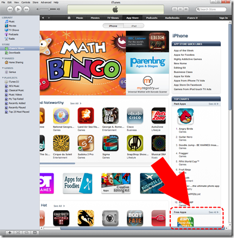](/images/uploads/2010/free-itunes-album-cover-artwork-embed-5dcc0a01428f.png)
Select “Free App” | [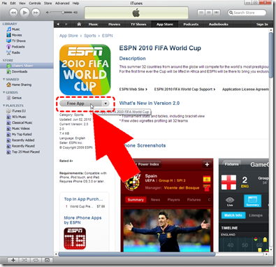](/images/uploads/2010/free-itunes-album-cover-artwork-embed-375d71ff374d.png)
Create New Account | [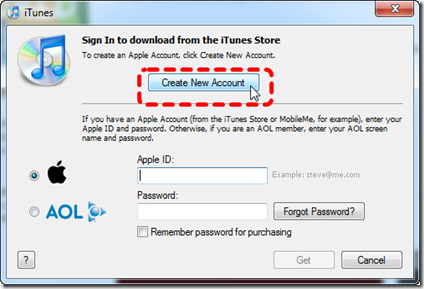](/images/uploads/2010/free-itunes-album-cover-artwork-embed-76a1c1f34caf.png)
Continue | [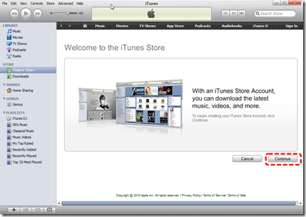](/images/uploads/2010/free-itunes-album-cover-artwork-embed-55ef19c3b3ad.png)
Accept & Continue | [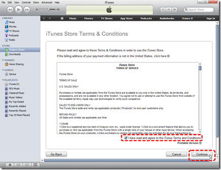](/images/uploads/2010/free-itunes-album-cover-artwork-embed-b081bb5b1aa4.png)
Enter Personal Info and Continue | [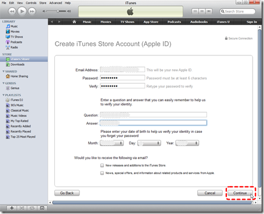](/images/uploads/2010/free-itunes-album-cover-artwork-embed-6a533c18e8e9.png)
This is the big enchilada… Select “None” for payment type. Note: this option only shows up when you start by selecting a free download. | [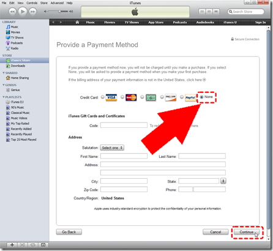](/images/uploads/2010/free-itunes-album-cover-artwork-embed-092ec8745dc4.png)
Done | [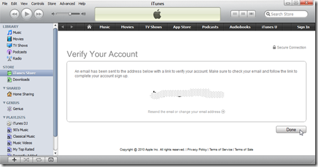](/images/uploads/2010/free-itunes-album-cover-artwork-embed-9f00b9df1268.png)
Confirm the verification eMail via embedded link | [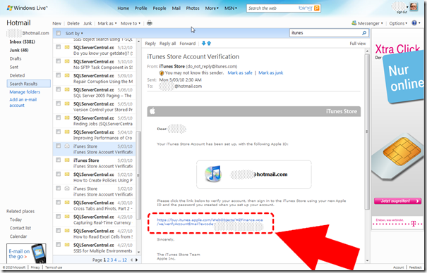](/images/uploads/2010/free-itunes-album-cover-artwork-embed-06f10d39e0e0.png)
Pop the little iTunes download thingy and sign in | [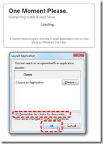](/images/uploads/2010/free-itunes-album-cover-artwork-embed-75a99d72fa27.png) [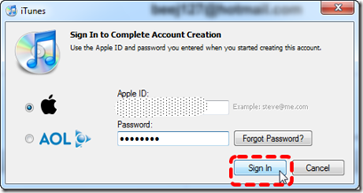](/images/uploads/2010/free-itunes-album-cover-artwork-embed-04ad052fcf6b.png)
If all has gone according to plan… you should be greeted with this pleasantry You now have an album art download capable yet free iTunes account 🙂 | [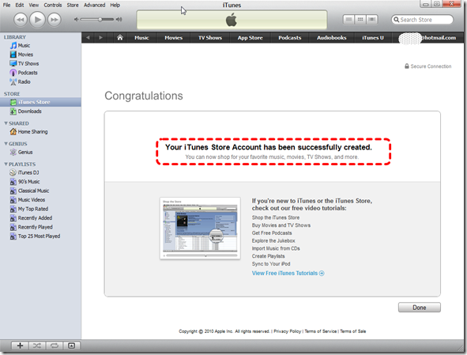](/images/uploads/2010/free-itunes-album-cover-artwork-embed-a136b13e04db.png)