References:

- [This "Torchy" guy has great info][link-1]{:target="_blank"}
- [FlashlightWiki.com][link-2]{:target="_blank"} is great to have at the ready for power comparison while eBay shopping each model

My first time up at bat was a CREE Q5 bike light: 5 mode, rated at 345 lumens = $17.50 w/shipping

I just charged up the batteries and tried the new Q5 345Lm torch… it's pretty flippin nice for <$25!… very intense center spotlight, but also a lot of wide spread to light up a full trail in the dark… looks like a winner!

[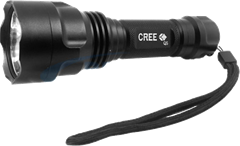][link-4]

[Update 09 Mar 2011]

CREE T6 seems to be latest/greatest, [750Lm T6 = ~$30 w/shipping][link-5]{:target="_blank"}

[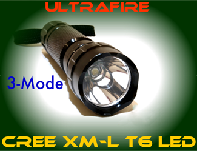][link-3]

CREE R5 *might* be a slightly better bang/buck bargain, [600Lm R5 = ~$20 w/shipping][link-6]{:target="_blank"}

[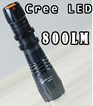][link-7]{:target="_blank"}

**Careful:** there appears to be a regularly advertised bogus 800Lm R5 that is actually a Q5 (which might still be pretty good 🙂 many of the auctions of these mention Q5 in the package contents

------------------------------------------------------------------------

According to [Torchy's 18650 battery tests][link-9]{:target="_blank"}, at 1A load, *everything* drops off well before 3000mAH.

- SenyBor, Panasonic, Sanyo & Samsung rated the best… unfortunately they're much less prevalent on eBay and are more like $10+ per battery rather than ~$5 like all the UltraFire fodder out there
- Apparently UltraFire's *never* perform up to their advertised rating… bummer, UltraFire's cheap & prevalent 3000 & 4000mAh were particularly lousy
- Another top end brand is "AW", [Protected "true" 2600mAh = ~$17 per][link-10]{:target="_blank"} (ouch)

Before I knew this, I got a simple charger combo with 3600mAh UltraFire's 18650 x 2 = $19 w/shipping, *so far so good*

[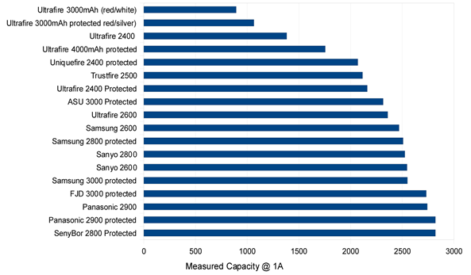][link-11]

[Another big battery test rundown][link-12]{:target="_blank"}… RediLast appear to be top notch… [$17 per 2900mAh cell (ouchy) + $6 USPS Priority shipping][link-13]{:target="_blank"} … I ordered 4 of these… we shall see…

[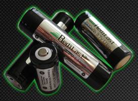][link-8]{:target="_blank"}

[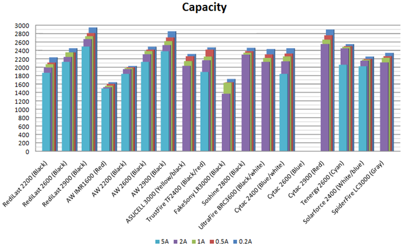][link-14]{:target="_blank"}

[Another 18650 Shootout:][link-15]{:target="_blank"}… The UltraFire 3000 Protected (Red/Silver) does uncharacteristically well on his test???

[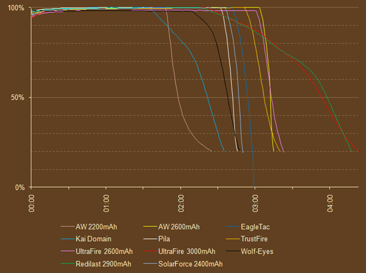][link-16]{:target="_blank"}

I picked up a couple of these 360 degree Handlebar mounts for $5.25 ea w/shipping… found some more for $2.43 w/ship… they're worth every penny

[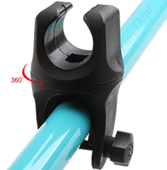][link-17]

The ones like this with 360 rotating feature are harder to find, very necessary for aiming the light from my "long horn" beach cruiser style handlebars. This item feels real good in actual usage, definitely recommended… made of a very flexible rubbery plastic, soft enough that I added a washer to both ends of the tightening bolt so that the bolt heads didn't just cut right through… the good thing is, after several trips in ~5C German weather, I can tell that this material will never shatter like so many others.

Notes:

- Handy eBay search: [cree q5 18650 –headband –headlamp -bulb][link-18]{:target="_blank"}
- Lithium rechargeable "18650" seems to be the preferable cell (see candlepowerforums.com)
  - vs <u>R</u>CR123 (aka 16340) = rechargeable
  - CR123 = non-rechargeable
  - [physical dimensions & other good basic background][link-19]{:target="_blank"}:
    - 18650 = 18 mm dia, 65 mm long
    - CR123 = 16mm dia, 34 mm long
    - my 3 x AAA cage = 21.5mm dia, 52mm long (this appears to be a [de facto standard][link-20]{:target="_blank"})
    - typical eBay fare will be a light that's electrically <u>compatible</u> with 3 x AAA or 1 x 18650 or 2 x CR123… but one must consider how they physically provide for the various battery configurations when pairing your desired light with your desired power source… these photos told me a lot:

      [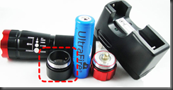][link-21]{:target="_blank"} [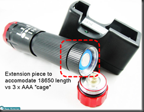][link-21]{:target="_blank"} [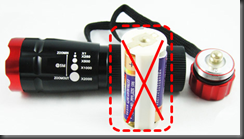][link-21]{:target="_blank"} [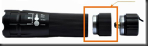][link-21]{:target="_blank"}
- Nashbar / NiteRider models:
  - [NiteRider MiNewt 350 = $190][link-22]{:target="_blank"}
  - [NiteRider Minewt Mini 150 = $80][link-23]{:target="_blank"} (Andrew's model, very bright)
  - [NiteRider MiNewt 200 = $150][link-24]{:target="_blank"}

[link-1]: https://www.torchythebatteryboy.com/p/which-led_21.html
[link-2]: https://flashlightwiki.com/Cree
[link-3]: https://shop.ebay.com/i.html?_nkw=%2B750+%2Bcree+%2BT6
[link-4]: /images/uploads/2010/cree-led-based-bicycle-lights-and-0aa1fd740f68.png
[link-5]: https://shop.ebay.com/i.html?_nkw=%2B750+%2Bcree+%2BT6
[link-6]: https://shop.ebay.com/i.html?_nkw=%2Bcree+%2Br5+%2B600
[link-7]: https://shop.ebay.com/i.html?_nkw=%2B800+%2Bcree+%2Br5
[link-8]: https://www.redilast.com/index.php?option=com_content&view=article&id=56&Itemid=88
[link-9]: https://www.torchythebatteryboy.com/p/batteries_21.html
[link-10]: https://www.cpfmarketplace.com/mp/showthread.php?230876-AW-s-LiIon-Batteries-Sales-Thread-*Part-12*
[link-11]: /images/uploads/2010/cree-led-based-bicycle-lights-and-945c959db02d.jpg
[link-12]: https://lygte-info.dk/info/Batteries18650-2011%20UK.html
[link-13]: https://www.redilast.com/index.php?option=com_content&view=article&id=56&Itemid=88
[link-14]: https://lygte-info.dk/info/Batteries18650-2011%20UK.html
[link-15]: https://light-reviews.com/forum/viewtopic.php?f=9&t=513
[link-16]: https://light-reviews.com/forum/viewtopic.php?f=9&t=513
[link-17]: /images/uploads/2010/cree-led-based-bicycle-lights-and-439db34f7be6.png
[link-18]: https://desc.shop.ebay.com/i.html?LH_BIN=1&LH_TitleDesc=1&_nkw=cree%20q5%2018650%20-headlight%20-headlamp%20-bulb&_trkparms=65%253A15%257C66%253A4%257C39%253A6&rt=nc&_dmd=2&_dmpt=US_Flashlights&_trksid=p3286.c0.m14.l1513&_pgn=4
[link-19]: https://www.candlepowerforums.com/vb/showthread.php?t=274657
[link-20]: https://en.wikipedia.org/wiki/De_facto_standard
[link-21]: https://cgi.ebay.com/1-set-CREE-Q5-3W-Bike-Headlight-Battery-charger-Ring-/330467170592?pt=LH_DefaultDomain_0&hash=item4cf160d920
[link-22]: https://www.nashbar.com/bikes/Product_10053_10052_517190_-1_10000__200399
[link-23]: https://www.nashbar.com/bikes/Product_10053_10052_516807_-1_10000__200399
[link-24]: https://www.nashbar.com/bikes/Product_10053_10052_504114_-1_201529_10000_200399
