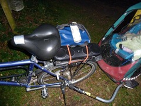
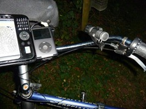
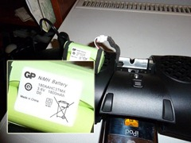
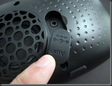
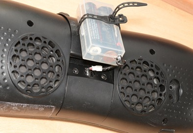
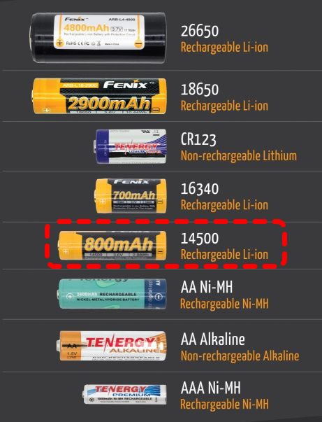
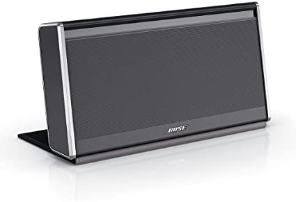

Looking for small-group biking… want some bass to carry to other riders in the immediate vicinity over typical road & wind noise... needs to be well contained for bumping around and not too heavy since we hop a lot of trains, stairs, etc

# Highlights
- Released Aug. 2010, Retail: $150, Street: $132
- 8 speakers! = 2 x 3" neodymium mid drivers, 2 x 1.5" neodymium tweeters, 4 x 2" passive bass
- 3 x AA **soldered** rechargeable NiMh battery pack; highly marketed @ 8 hours; too bad not Li-ion; at least it's a user serviceable pack
- 3.5 lbs (perfect)
- Standard 3.5mm audio input jack
- Remote
- A/C wall brick
- Travel sack

# Reviews
- [Logitech's product detail page](https://support.logi.com/hc/en-us/articles/360023305954-S715i-Technical-Specifications)
- [Logitech's own YouTube demo](https://www.youtube.com/watch?v=aaXWkwym1ak)
- [iLounge.com review](https://www.ilounge.com/index.php/reviews/entry/logitech-rechargeable-speaker-s715i)

# My experience
      
just gave them a test run tonight 22 Sep 2010
they bang pretty nice off the back bike rack
compared to the logitech 28mm i had before (eBay = $30, no longer available), they are better enough to be worth $150 to me
iPhone compatible
feel solid, not as bulky as i expected
Battery = NiMH 180AAHC3TMX 3.6V 1800mAh (see photo)

## Batteries!!
 I've already started maxing out the battery life during our rides… we saw around 6 hours last ride… to be fair, once I turned down the volume, the light went green for another hour or so… but who wants low volume!?!?  I'm gaga over the [high beam LEDs that run on 18650 Li-Ion rechargables as my main bike headlamp](/2010/09/cree-led-based-bicycle-lights-and.html)... so I hacked together 2 cells in parallel ... 18650 is too long to fit the existing battery cavity so i just strapped my makeshift box on the outside... i was in too much of a hurry and the whole thing is glitchy under road conditions but it <mark>definitely proved the theory that a 3.7v supply is fine</mark>.

 Li-Ion cells are great... i think the next best shot is to get few 14500's which are also 3.7v and basically the same size as AA's so they should fit in the existing speaker cavity... probably fill the same space with three in parallel to get enough duration, since they tend to be a lot less mAh than 18650's.

## Show Off
 Since we're all riding together, a buddy with more disposable income =) one-upped me with a sweet Bose SoundLink bluetooth box for around $300 ... those are definitely another notch or two up the ladder... great sound, very well built rectangular package that lends itself to bungee'ing to a rear bike rack, etc... the wrap around cover that doubles as a stand, can be easily removed, providing some raised Allen screws convenient for mounting.  We couldn't resist cracking it open to check the juice and sure enough it was 3 x 18650's =)
