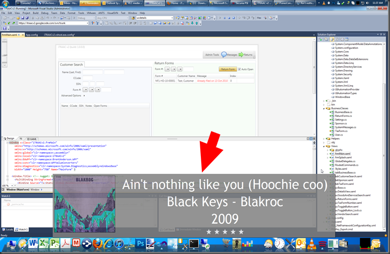

<a href="https://itunescontrol.com/" target="_blank">This thing totally rocks</a>!… essentially flawless implementation of global hotkeys plugin to control iTunes and also sweet configurable heads-up-display functionality (example shot below)… if you’ve been looking for this kind of functionality, look no further! (waaaay more functional than the clunky Aqua-Soft mmKeys.dll plugin that’s out there) Super bonus points: the developer Carson Morrow is a great guy… very responsive! [][1]

 [1]: /images/uploads/2010/itunescontro-aff4a5641554.png