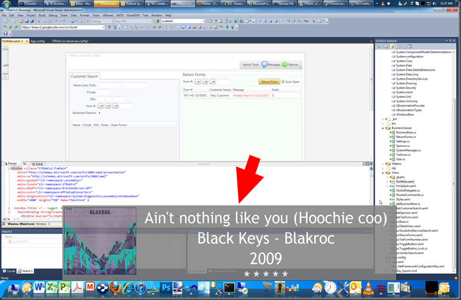

[This thing totally rocks](https://itunescontrol.com/)!… essentially flawless implementation of global hotkeys plugin to control iTunes and also sweet configurable heads-up-display functionality (example shot below)… if you've been looking for this kind of functionality, look no further! (waaaay more functional than the clunky Aqua-Soft mmKeys.dll plugin that's out there) Super bonus points: the developer Carson Morrow is a great guy… very responsive! [{: style="height: 504px; width: 773px; background-image: none; border-bottom: 0px; border-left: 0px; padding-left: 0px; padding-right: 0px; display: inline; border-top: 0px; border-right: 0px; padding-top: 0px" border="0" }][1]

 [1]: /images/uploads/2010/itunescontro-aff4a5641554.png