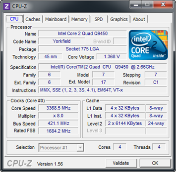
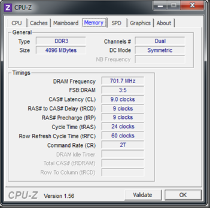

(see <a href="/overclocking-skeletor-q9540-v10/" target="_blank">round 1 notes</a> for full specs) After watching a quick youtube of a guy that hit 3.9Ghz (485MHz FSB) where he didn’t bat and eye about leaving his DDR2 at something around 1000MHz, I decided to copy his lead and give up on the 1:1 DRAM:FSB thing and just go for the CPU gusto… I wasn’t seeing much love at 485… it would somehow boot if I goosed the DRAM to 1349 or something like that… but Win7 would reset after boot logo… lower DRAM frequencies wouldn’t even boot until I set it to auto and it came back with 971 🙁 I’m at 420 FSB with 1400 DRAM now and holding in Win7 for a nice stretch here… that’s around 3.4GHz which is at respectable 26% increase… we shall see. Primary OC BIOS settings (gleaned <a href="https://www.youtube.com/watch?v=_-ksS41TxvI" target="_blank">from here</a>) 

  * CPU Ratio = 8 
  * C1E = disabled (I have no idea) 
  * Max CPUID = disabled (ditto) 
  * FSB = 420 
  * FSB Strap = Auto 
  * PCIE Freq = 100 
  * DRAM freq = 1400’ish 
  * CPU Voltage = 1.39375 (he read that was the safe max somewhere) 
  * DRAM Voltage = 1.8 … haven’t played with this at all yet to see if lower would suffice 

Temps reported from Everest:   
Motherboard&#160;&#160;&#160; 34 °C&#160; (93 °F)   
CPU&#160;&#160;&#160; 33 °C&#160; (91 °F)   
CPU #1 / Core #1&#160;&#160;&#160; 44 °C&#160; (111 °F)   
CPU #1 / Core #2&#160;&#160;&#160; 44 °C&#160; (111 °F)   
CPU #1 / Core #3&#160;&#160;&#160; 43 °C&#160; (109 °F)   
CPU #1 / Core #4&#160;&#160;&#160; 41 °C&#160; (106 °F)     
[][1][][2]

 [1]: /images/uploads/2010/overclocking-skeletor-q9450-round-2-b37f0b66e8c0.png
 [2]: /images/uploads/2010/overclocking-skeletor-q9450-round-2-582d307c0c4b.png
