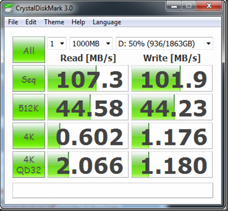
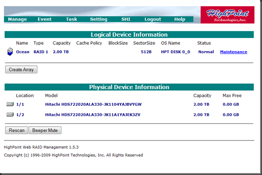
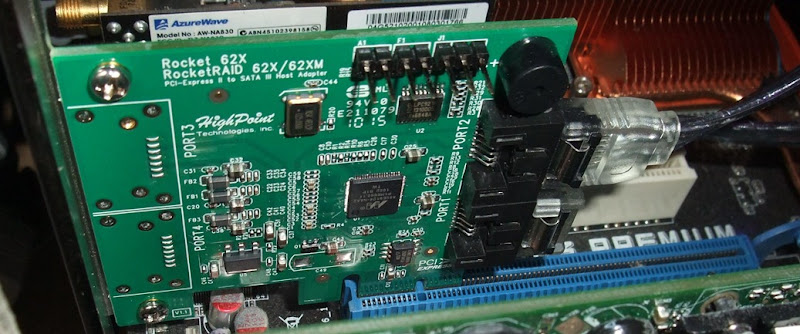
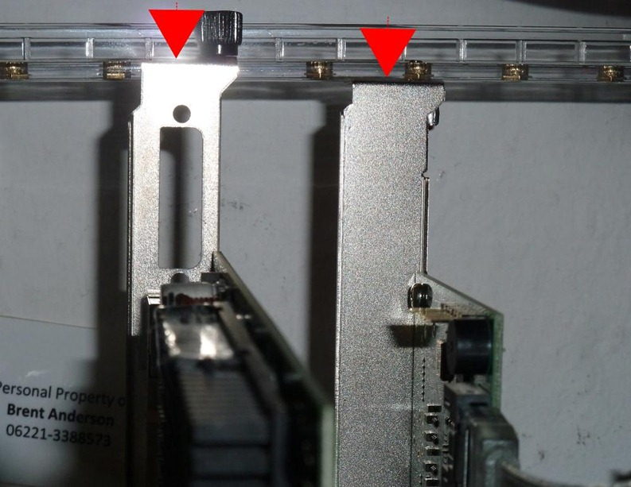

Update [2011 Aug 6]: The original drivers appear to work just fine under Lion v10.7
  
I’m very satisfied for a $60 part… the drivers loaded right up under both Win7 and OS X v10.6.6 (and 10.7 currently)
  
As a side note: This all works well in tandem with Parallels Desktop v6’s Boot Camp virtualization facility where I can dual boot into my one sole Windows 7 install _natively_ or via a Parallels VM under OS X (I know VMware has something identical but from what I’ve read, Parallels still has the edge on performance).
  
The drivers on the install disc were up to date… and I’m taking it as a good sign that they haven’t found need to update them for over a year now.
  
[Windows 7 Driver][3] – currently: v1.1.9.1221, 12/21/2009
  
[OS X Driver][4] – currently: v1.1.0, 12/22/2009
  
There is the usual BIOS based boot time configuration screen you can pop into to manage your arrays.
  
And you can also install a management “Web GUI” … this is obviously driven by a mini web server that runs under your OS on a certain port… this is _NOT_ plugging an ethernet cable into the RAID card itself… it is not that sophisticated… the whole thing is very bare bones, very old school but seems to have the basics covered (time will tell)… it’s loaded via an old Installshield style setup.exe that I recognize from the early 90’s … the web screens themselves are completely boring old school stuff which stands out in a bad way these days but truly, <ValleyGirlMode> whatevers </ValleyGirlMode>.
  
looking at the benchmark from CrystalDiskMark… those sequentials look respectable but I guess the other rates are pretty poor???
  
those specs are running the RocketRAID on these drives: **<a href="https://www.newegg.com/Product/Product.aspx?Item=N82E16822145276" target="_blank">Hitachi Deskstar HD32000 IDK /7K</a> (2TB 7200 RPM 32MB Cache SATA 3.0Gb/s 3.5&#8243; Internal)**
  
[][5]&nbsp;&nbsp;&nbsp;&nbsp;&nbsp;&nbsp; [][6]
  
The card itself is very miniscule… about 2.75&#8243; inches square (see below)… it is a “1 lane” card (i.e. “X1” in the PCI-express common parlance)… but it is PCIe 2.0 so you absolutely want to put it in a 2.0 capable slot if you can and on my mobo that is a x16 lane slot… which “looks” like a waste but is totally fine for me because I’m not a gamer so I’m not using that secondary PCIe x16 slot for an SLI gfx card or anything useful anyway.
  

  
Checkout this last photo… I realized the RocketRAID card’s bracket alignment was off quite a bit (too short)… after installing, the card would slide itself loose of the slot… so much so that the mobo’s electric disconnect warning light for that slot came on… the bracket for my graphics card right next door doesn’t exhibit anything close to this height deficit so I’ve got to assume the RocketRAID is a bit out of spec… after scratching my head for a minute, the obvious solution that presented itself was to move the bracket _under_ my case’s _card stability rail..._ it seems like my <a href="/open-air-pc/" target="_blank">Antec Skeleton</a>’s card rail particularly lends itself to this approach… I wonder if a normal case’s bracket screw down area would ?
  
[][7]

 [3]: https://www.highpoint-tech.com/BIOS_Driver/page/rr620_U.htm
 [4]: https://www.hptmac.com.cn/China/rr620c.htm
 [5]: /images/uploads/2011/highpoint-rocketraid-620-indeed-works-1a68b70809b6.png
 [6]: /images/uploads/2011/highpoint-rocketraid-620-indeed-works-34c1bba5b511.png
 [7]: /images/uploads/2011/highpoint-rocketraid-620-indeed-works-59b28cc19493.jpg
