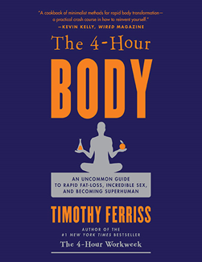
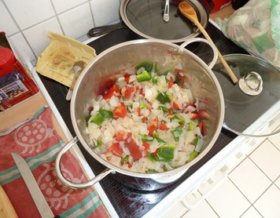
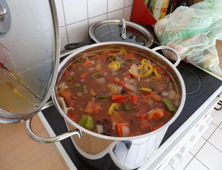

 Ferris gets right to his go-to Mexican oriented mix pretty quick into the fat loss section of the book… it's very quick reading to pick up his basic approach. &nbsp; Here's how we've taken that and made it our own:

  * Full Size White Onion chopped up (probably any kind of onion will do) 
      * Full Size Tomato chopped up 
          * Full Green or Red Bell Pepper chopped up 
              * Can of Black Beans (pinto and kidney work as well of course… we just really like black beans) 
                  * Grilled Large Chicken Breast
                Those items are all basically on a 1:1 ratio. _**5**_ of each fills our 6 quart "stock pot", which will last the two of us through a work week. Along with those primary stock items, we also flavor in some diced garlic… I love garlic, I go kind of nuts with it. To spice it up, I do a full 16 oz. jar of Vlasic _**hot**_ pepper rings (what I call pepperoncini's)&nbsp; -AND- a full 12 oz. jar of sliced hot jalapenos… including the juice from both (keep an eye out for corn syrup here)… those give it a fun kick… which should also help manage appetite. I think you'd want the full 5x of everything else to take on those full jars of spiciness… please start out with less until you find your preferred balance. To help freshen up each reheated serving, we melt in some grated cheese (keep it very minimal since this is on the avoid list), then toss on a dollop of sour cream and some avocado slices. Tim gives pointers on what to avoid just as much as what to embrace… pretty much all fruit sugars are on the avoid list, no big surprise. Another is to avoid many things that are white due to flour or starch, which is also a fairly common thread of advice from other dietary sources. It's nice to load up the digital version of the book and hit the hyperlinks to the references… the weight tracking spreadsheet, etc. Good luck with your goals and have fun! 🙂 