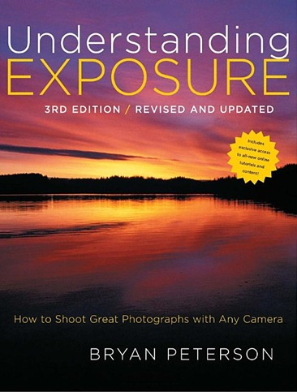

This is book by Bryan Peterson was nicely approachable

  
**ISBN-10:** 0817439390  
**ISBN-13:** 978-0817439392

Make sure you get the latest edition (currently Aug.2010).

Bryan has a an easy going writing style packed with tons of real examples.

It's not a very long book (~175 pages) and there are lots of great example photos filling up nearly every page.

It is highly rated on Amazon… only $20 with shipping.

Basic takeaways for my own future reference:

*   Bryan uses the term "Exposure Triangle" to relate the three interrelated fundamentals of capturing ideal exposure: F-stop (aperture size), Shutter Speed and ISO.
*   Photography of course has a lot to do with ***light*** … how much light we have to work with and how much we want to let into the camera.
*   <u>**ISO**</u>
    *   Undoubtedly the toughest one to grasp at the pure physics level. I appreciate how Bryan uses the simple metaphor of "worker bees" here.
    *   The higher the ISO, the more worker bees you have on your electronic photo sensor gathering the light particles. There is of course a trade-off and I think we've all observed the grainy result of too much ISO.
    *   It's great to read the specific values & tips Bryan recommends throughout the book… e.g. setting your ISO higher than 200 starts to lose contrast and color saturation.
*   **<u>f/stop</u>** (aperture size)
    *   aperture is literally the size of the opening allowing light to enter the camera… Yet just controlling the amount of light is not really the most useful aspect of f-stop…
    *   More importantly f-stop is what determines the "depth of field" in a photograph.
    *   F/4.5 is a very "average" middle point to begin with.
    *   The ***higher*** the F/# the ***smaller*** the aperture (light opening) (because the number is on the bottom of a division)
    *   Smaller apertures wind up pulling in a greater "depth of field" which just means **more of the background is sharper**.
    *   Wider apertures (*smaller* f/#'s, i.e *divided* by a smaller number = bigger) give that fuzzy background effect ([bokeh](https://en.wikipedia.org/wiki/Bokeh))… typically when you want to draw the most attention to a specific subject vs a complex background.
*   **<u>Shutter Speed</u>**
    *   this is the most intuitively obvious one in my mind… it primarily determines whether you capture motion or not… a quick shutter "stops action"… a slow shutter gives that more blurry look to moving objects like water.

We then balance all three of those in our "Exposure Triangle"…

For one example, starting with the desire to have full focus on a long view (e.g. big field of flowers), we select a high f/stop. If it's a bright easy light day, we can leave our ISO low … lastly we move the shutter speed up or down <u>until our camera's light meter falls on ZERO</u>.

<mark>I had never been clued in on that fundamental part about adjusting one or the other (aperture or shutter) in order to move the light meter bar back to center zero.</mark>  One typically does this looking through the viewfinder at the little gauge of vertical bars. Again, the objective is to get the indicator to be as close to center as possible.

This was a pretty big revelation for me.  Maybe I'm particularly clueless 🙂 and it's considered so obvious that it's not worth mentioning; but I also wonder how many people carry around multiple hundred dollar cameras without knowing this.

For an alternative example, if we want to capture that "blurry water" effect on a stream or a waterfall, we'll start with a longer shutter to (e.g. 1/8 sec or even 1 full sec) and then move the f/stop to get the light meter to 0… the f/stop will be high in this case (perhaps even f/32) because a long shutter is a long exposure to light and therefore a correspondingly small opening is necessary to counteract that light washout (i.e. overexposure).
