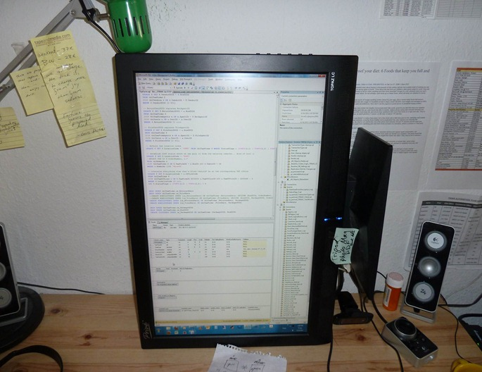

Do you realize how freakin’ cool it is to be able to hit ALT-F1 on a table in SSMS and be able to immediately view all of the output without futzing around in all the little result-set scroll bars!?! There’s 6 tables that come back from sp_help and now they have the room they deserve… the visual query plan tool is more horizontal so I have a feeling that’s going to take a little hit… we’ll see. Great for dual pane WPF dev in VS2010 too… with a typical visual pane up top, there’s now tons more room for raw XAML in the bottom … and XAML gets verbose in a hurry so this was becoming a critical annoyance for me. And not only dev oriented activities, Outlook feels better too… and it’s amazing how many web pages seem like they were made for portait… so nice to see a whole page at once w/o a scroll bar. Bottom line: THE most dramatic yet drop dead easy computer improvement I’ve done in a long time. [][1]

 [1]: /images/uploads/2011/going-portrai-8a1b8dda3999.jpg