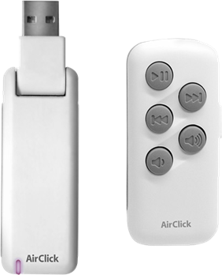
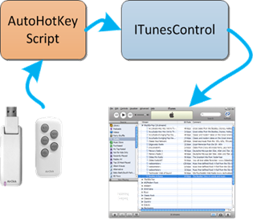

This little bugger just so totally rocks!!!  IMHO the most compelling aspects are:

  * It's cheap :). They tend to go for around $10-$25. There are still some out there on <a href="https://shop.ebay.com/i.html?_nkw=airclick+usb" target="_blank">eBay</a> from time to time (not now) and also <a href="https://www.amazon.com/s/ref=nb_sb_noss?url=field-keywords=airclick+usb" target="_blank">Amazon</a> at the moment. 
  * It's Radio Frequency technology – so you can zap iTunes to the next song from around the corner or out in the yard!!  Even my fancy <a href="https://www.soundgraph.com/vfd-feature-en/" target="_blank">iMON VFD</a> remote is <a href="https://en.wikipedia.org/wiki/Infrared_Data_Association" target="_blank">Infrared</a> based (limited by line-of-site) and that winds up being a deal breaker in my environment… couch faces projector wall away from the PC, IR = major fail! 🙁 
  * It's simple! – there are only the 5 most critical buttons to distract you… none of that typical Windows Media Center remote overload to worry about here… Play/Pause, Previous, Next & Volume Up/Down, that's it. 

Unfortunately, the vendor, Griffin, has chosen to discontinue this little wonder.  If you're interested in driving your PC based Media Players, make sure get the USB version, not the iPod version which appears to still be in production. Take note, the transmitters that come with the readily available iPod version are 100% compatible with the USB receiver. This is a nice way for us to obtain replacement transmitters to have around.  Just check eBay… I just got a pair of clickers, including the iPod receiver and an interesting Velcro mount for $4.50, including shipping!!! ~~Griffin is nice enough to continue hosting their support page with [drivers](https://www.griffintechnology.com/support/airclick-usb)(long dead)~~ (alternate download of "[AirClickUSB_Win_2_0_0.exe](https://clicknupload.co/cfx2we7h8ge1)").  These native drivers work on any <u>32bit</u> Windows since XP (more on 64bit support below). And <a href="https://www.dimin.net/software/airclick/" target="_blank">Dmitry Fedorov</a> has been keeping the dream alive by showing us how to build our own little application-specific .Net plugins for the basic Griffin driver API. Ok so that's all fine and dandy, now let's get to the good stuff!!   
I currently like iTunes and VLC and Windows 7 64bit and I've found a couple free wares that well, make beautiful music together (couldn't resist 🙂 

<a href="https://itunescontrol.com/" target="_blank">iTunesControl</a> – In his infinite wisdom, Mr. Jobs hasn't seen fit to support _global_ Windows Media Keys in iTunes … fortunately for us, Carson created iTunesControl. Within the HotKeys section, one must simply click the desired key event (e.g. "Next Track") and then press the corresponding AirClick button to make the assignment (Don't forget to hit the Apply button).  It also provides a very nifty, super configurable Heads Up Display that I absolutely love. To be more specific, I only mapped Play/Pause, Next & Previous this way.  I left volume up/down defaulted to Windows global volume which provides convenient system wide volume control no matter what's active (see last paragraph). 

Now, the dark clouds started rolling in when I upgraded to Win 7 64bit and realized that the basic Griffin software install does not happen under 64bit, zip, nada, no-go <waaahh>… then I found this next little gem, affectionately called… 

"<a href="https://www.slothlovechunk.net/projects/airclick_interface_script.html" target="_blank">AirClick Interface Script</a>" - The way Jared explains it, fortunately for us, at least the <a href="https://en.wikipedia.org/wiki/Human_interface_device" target="_blank">HID</a> layer of the Griffin driver is operational under 64bit. So he wrote an <a href="https://www.autohotkey.com/" target="_blank">AutoHotKey</a> script which picks up on the HID messages coming from the AirClick and turns those into Windows Media Keys.  The WinMedia Keys are then caught by iTunesControl and iTunes immediately does our bidding, brilliant! Jared provides his original script source as well as a convenient compiled exe version that you just run and go. 

[][1]NOTE: Jared's script maps a 4 second press of the volume-down to PC go night-night. To me this isn't so handy and I much rather have a repetitive volume adjust when held down. So I tweaked his script a little, <a href="https://code.google.com/p/beejcode/source/browse/trunk/Griffin%20AirClick%20AutoHotKey%20Script/airclick-nosleep.ahk" target="_blank">find that here</a> (<a href="https://beejcode.googlecode.com/svn/trunk/Griffin%20AirClick%20AutoHotKey%20Script/airclick-nosleep.exe" target="_blank">ready-to-run EXE version</a>). If you wish to run this raw script or perhaps compile some of your own tweaks, then you <a href="https://www.autohotkey.com/download/" target="_blank">must use the original AutoHotKey</a>. The newer "AutoHotKey_L" branch would not work for me. The last thing I'll mention is subtle but neato… Jared's script actually checks to see which window is active.  If none of the well knowners is focused (VLC, Winamp, MediaPlayerClassic, PowerDVD), then it defaults to firing Windows Media Key events.  The nice thing is, if say VLC is active, then Jared's script fires VLC specific play/pause, rewind & fast forward keys … so if I'm bouncing around the house, iTunes is getting the WinMedia events… if I'm sitting down watching a movie, I just have to make sure VLC is the active window and iTunes is left alone, perfectly intuitive! UPDATE 10 March 2012 It's a nice pastime to watch a photo slideshow while listening to tunez. Previously I'd been using the Google Photo Screensaver. But we soon wanted the ability to <u>back up</u> and stare at one of the slideshow photos, <u>via the remote</u>. I found <a href="https://pssp.svoboda.biz/" target="_blank">Photo Screensaver Plus</a> by Kamil Svoboda to fit very well. Among other very robust functionality, it supports _left cursor_ to back up in the photo stream and _space_ to pause the slideshow. With that, I edited my <a href="https://beejcode.googlecode.com/svn/trunk/Griffin%20AirClick%20AutoHotKey%20Script/airclick-screensaver.ahk" target="_blank">new AutoHotKey script</a> (<a href="https://beejcode.googlecode.com/svn/trunk/Griffin%20AirClick%20AutoHotKey%20Script/airclick-screensaver.exe" target="_blank">exe</a>) to provide the following:

  * when slideshow screensaver is not running, hold down play/pause remote button to start up screensaver slideshow 
  * when slideshow is running, reverse button goes to the previous image and pauses the slideshow 
  * when slideshow is paused, play/pause restarts the slideshow 
  * otherwise all buttons pass through to media events as usual 

I really like how you can dual purpose the buttons depending on the context… that's powerful. Kamil's screensaver also provides a hotkey to copy the current image to a favorites folder, very cool.  And a hotkey to edit the image's EXIF metadata – Name, Description & Comment.  The nifty thing there is we also publish our photos via a Zenphoto web image gallery. Once we edit the EXIF info in the screensaver, a little PowerShell script of mine refreshes ZenPhoto's MySQL database entry for that image so the new image name and comments are immediately available for viewing and SEARCHING via the web gallery's search facility, nice!  The PowerShell script uses Microsoft's <a href="https://archive.msdn.microsoft.com/PowerShellPack" target="_blank">PowerShellPack</a> to provide effortless FileSystemWatcher integration. We really do have everything we need to mix and match unintentional building blocks into our own satisfying hobby solutions these days with amazingly little effort. I mean, who could've anticipated using a screensaver of all things as a data entry front end?   <a href="https://sites.google.com/site/programsforpeers/hotcorners" target="_blank">Hot Corners</a> - This free tool does the job and AutoIT source code is provided.

 [1]: /images/uploads/2011/ode-to-griffin-airclick-usb-radio-3fa6c593ed0f.png
