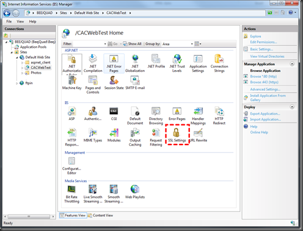
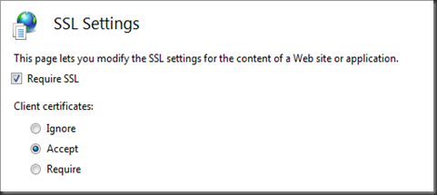

  * The only configuration settings required are (IIS7 screenshots below): 
      * Require SSL (this represents server side) 
      * and either Accept or Require Client Certificates … “Accept” will populate the SmartCard’s cert info to your ASP.Net Request object (if it’s provided) but won’t deny access if one hasn’t been provided, “Require” will deny access unless a valid SmartCard Cert has been provided. 

Tips:

  * One key thing to be aware of how this works is that the server will send a list of Trusted Root Certificates down to the client/browser and then the browser will compare that list to the Trusted Roots represented by the CAC present and only if there’s a match will it prompt for the Certificate and PIN input.&#160; Therefore, both the Server and the client must have the same Trusted Root Certs installed for this to work, the easiest way to do this for the DoD CAC’s is to grab the latest install_root.exe and fire that up. 
      * DoD root certs: [https://iase.disa.mil/pki-pke/function_pages/tools.html#trust][1] 
  * Another key thing I discovered was that after you get the certs installed, go ahead and do a reboot, I was still getting 403 access denied errors that simply disappeared after I rebooted. 
  * Throw these lines in a ASP.Net wizard generated project’s Default.aspx to see the basic Cert info… the .Subject property is the juiciest looking info, there may be other properties of value. 
      * <%=Page.Request.ClientCertificate.IsPresent%> 
      * <%=Page.Request.ClientCertificate.Subject%> 
  * It’s probably also helpful to go ahead and make sure your server side SSL cert is properly named & not expired, such that you don’t get any warnings when you browse to the page… I was getting some errors related to that when I was working with the Client Cert’s required.
  * <a href="https://www.sslshopper.com/article-how-to-create-a-self-signed-certificate-in-iis-7.html" target="_blank">this reference was helpful</a>, see the section titled “Generate a Self Signed Certificate with the Correct Common Name”
  * this is the basic command you need to generate your own SSL cert for testing: SelfSSL /N:CN=www.whatever.com /V:9999
  * find SelfSSL in the <a href="https://www.microsoft.com/download/en/confirmation.aspx?id=17275" target="_blank">IIS6 Reskit</a>

[][2]&#160;[][3]

 [1]: https://iase.disa.mil/pki-pke/function_pages/tools.html#trust "https://iase.disa.mil/pki-pke/function_pages/tools.html#trust"
 [2]: /images/uploads/2011/cac-smartcard-enabling-aspnet-on-iis-c2e8f65a8f9c.png
 [3]: /images/uploads/2011/cac-smartcard-enabling-aspnet-on-iis-72106d86adce.png