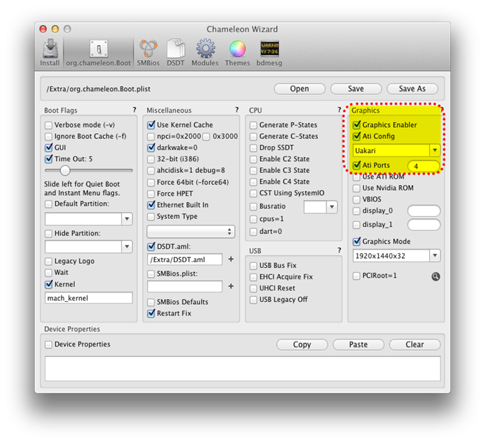
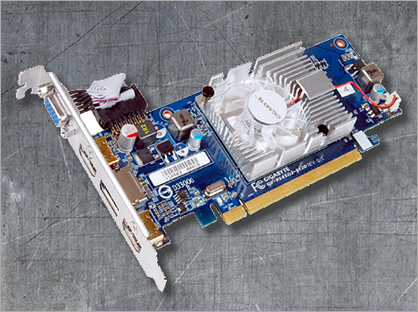
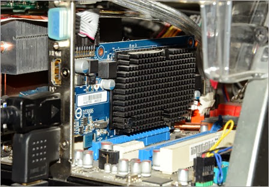

([my X1300 post](/ati-x1300-pro-on-mac-os-x-snow-leopard/)) I still believe someone will get the x1300 running QE on Lion… the fact that the old 7187 DevID is still present in AT13000Controller gives me faith … if it weren't for another motivation, I would just wait. My other motivation is that it would be nice to upgrade to 3 displays, adding a Dell 30" to the current 24" and projector. So, my criteria are: Fanless, reasonably Hackintosh compatible, 3 display support, <$100 (the x1300 was $30 🙂 and lastly, nothing too hot/huge … turns out, there aren't really that many obvious options to choose from… I've come to understand that to go from 2 displays to 3 displays basically requires a DisplayPort capable card aka "DP" (at least in ATI land… I'm less familiar with nVidia models). Apparently DVI/HDMI/VGA all require their own clock, and contemporary consumer cards tend to be implemented with only two clocks, hence the plethora of dual display cards. DisplayPort doesn't require a clock as it is "[packet based](https://www.google.com/url?sa=t&source=web&cd=1&ved=0CBgQFjAA&url=http%3A%2F%2Fen.wikipedia.org%2Fwiki%2FDisplayPort&rct=j&q=wiki%20display%20port&ei=Ft5hTrqxB8uN4gTU-YDRCg&usg=AFQjCNF_29AmWs33XS7zZrLI29v2hYAvdQ&cad=rja)". There is the [Sapphire "Flex" line](https://www.google.com/products/catalog?q=sapphire+flex+5670&hl=en&biw=1920&bih=980&prmd=ivns&um=1&ie=UTF-8&tbm=shop&cid=1787890280223733533&sa=X&ei=edZhTpHBFZT04QTl1PWbCg&ved=0CEQQgggwAA) which implements an additional clock to drive three DVI/HDMI ports, but those are dual slot and more expensive than I'm looking for. So, out of the gate, I really liked the [Sapphire ATI 5670 Ultimate](https://www.quietpc.com/gb-en-gbp/products/vga-cards/sap-hd5670-ultimate) … it has exactly all three ports I want: DP+HDMI+DVI, it's single slot, the cooler looks "right" and it's the very last stage before cards require the extra power connector, perfect!… furthermore, the 5670 was [stock hardware in 2010 iMac's](https://www.google.com/url?sa=t&source=web&cd=2&sqi=2&ved=0CB0QjBAwAQ&url=http%3A%2F%2Fen.wikipedia.org%2Fwiki%2FIMac_\(Intel-based\)&rct=j&q=wiki%20imac&ei=KM5hTtDlB4TP4QTdlMWbCg&usg=AFQjCNFKkAI0PTqq8bAT-gUsUwYc9hHErw&cad=rja) and there's a 5670 listed on the [10.7 HCL requiring zero mods](https://wiki.osx86project.org/wiki/index.php/HCL_10.7.0#ATI) for full functionality… but wouldn't you know it, this perfect card appears to be discontinued in US markets!! 🙁 If you can find one of those buggers for <$100, I would hold on to it like gold. I was finding them for around $132 USD in Euro markets. If you go up from there, everything just gets unnecessarily big & hot for my needs… so I went down, and the next thing I ran into was the ATI 5450… There is a 5450 listed on the 10.7 HCL requiring only one simple [ATI5000Injector.kext](https://www.mediafire.com/?78ae8gc80jgr7hu) (and I've now confirmed for myself that this does work with full res/QE in Lion)… fanless 5450's are prevalent… VisionTek, HIS & Sapphire have viable candidates … one slight downside is that the most ubiquitous 5450 package has VGA for the third port… so the projector has to go on VGA rather than HDMI/DVI… initially that seemed like an annoying step back into analog but I tested my projector on VGA and it was just as clear as HDMI. VisionTek's DP capable models are the 900315 and [900320](https://www.visiontek.com/products/productivity-cards/dmssff.html) (900320 looks to be the 900315 bundled with low profile bracket and some adapters)… The VisionTek's are out there… best deal I found (including used) was a new [900315 direct from Amazon for $65](https://www.amazon.com/VisionTek-Radeon-Express-Graphics-900315/dp/B003ICX0A4/ref=sr_1_1?ie=UTF8&qid=1315037248&sr=8-1)… be careful, there are tons of mislabeled non DisplayPort VisionTek 5450's for sale… I shipped one for $47 only to find out it was HDMI rather than DisplayPort (looks like it's actually a 900358)… The VisionTek VGA+HDMI+DVI configuration is _very_ prevalent… the DP ones are harder to find… I checked with several vendors on Amazon and eBay and kept running into mislabeled HDMI models. HIS's fanless 5450 DP is the [H545H1GDL](https://www.google.com/url?sa=t&source=web&cd=1&ved=0CBUQFjAA&url=http%3A%2F%2Fwww.hisdigital.com%2Fun%2Fproduct2-506.shtml&rct=j&q=H545H1GDL&ei=1d9hTtLsLa_U4QSyorWWCg&usg=AFQjCNHKZQXIa_pmioAbCUJu2SVFv2UhOg&cad=rja), couldn't find any. Sapphire's fanless 5450 DP models are [11166-00 and 11166-09](https://www.overclockersclub.com/reviews/sapphire_radeon_hd5450_512mb/5.htm), couldn't find any of those either. So it was basically down to the VisionTek… as I said, ordered one, got the wrong model, but it does great in Lion by the way… dropped in the ATI5000Injector.kext before swapping cards and it booted right into full res/QE glory first shot… too easy. All three ports were immediately recognized in Lion. So I was about ready to bite the $65 bullet on the only solid 900315 I've found… then I had an idea… I noticed the coolers on the 5450 I had received and my old x1300 are basically the same… the mount holes are definitely the same… and there's this nifty [Gigabyte 5450](https://www.gigabyte.com/products/product-page.aspx?pid=3639#ov) that I've had in the corner of my eye… <u>it has a fan</u> but it uniquely provides 2 HDMI ports in lieu of the much more prevalent single DVI configuration… that's pretty cool because I can stay all digital with the projector on HDMI and readily adapt the other HDMI to DVI for my 24" LCD. Keep in mind, it is only 512MB DDR2 compared to 1GB DDR3 on the VisionTek's but I'm pretty sure it'll be fine for my needs, because my x1300 is only 256MB DDR2… This Gigabyte 5450 is readily available for [$40](https://www.newegg.com/Product/Product.aspx?Item=N82E16814125358&Tpk=GV-R545D2-512D)! And this month, there is a $15 mail in rebate (ends Sep.30 2011), putting this card at $31 with shipping… you just can't beat that. So Plan A is, well, maybe the fan will actually be quiet, perhaps with a speed limit resistor. And I'm sure you can guess that Plan B is swapping the heat spreader from my x1300. If you already have an x1300 or similar low profile cooler, it might just come in handy to slide you into this cheap Lion compatibility/upgrade path… all the other aftermarket coolers I could find are [undesirably large heat pipe affairs](https://www.zalman.com/ENG/product/Product_Read.asp?idx=147) (obviously trying to cater to a wide range of heat profiles). 

And that's basically why I blathered on about all this… for anyone else with waning feelings for their old x1300, the Gigabyte GV-R545D2-512D might just be a nice, cheap, low profile upgrade… Update 28 March 2012 – I can definitely recommend this heat spreader swap hack with the Gigabyte GV-R545D2-512D. The fan based sink that comes with is definitely a noise generator but the fanless heat sink from the X1300 lines up perfectly. The card temps are no issue. I've been running it for <strike>several months</strike> couple years now. Just upgraded to Lion 10.7.3. One annoying card bug, if I drive a single screen, the display will go completely haywire after a while. Everybody on NewEgg seemed to have the same problem so it's probably a core design issue in this model. It's a fairly random timeframe. But driving two displays, <u>this never happens.</u> If you don't have two displays (which why bother getting this card), then you can actually connect two of the outputs to the same monitor and that is enough to avoid the issue. Update 16 Oct 2013 – Running great on OSX 10.8.5 w/o issue. Pretty sure ATI5000Injector.kext stopped working as of 10.8.4 update so I switched back to manual editing the DeviceID (0x68f9) into ATI5000Controller.kext/Contents/info.plist and AMDRadeonAccelerator.kext/Contents/info.plist. Looks like these cards still available out there ([iboyds.com = $37](https://www.iboyds.com/gigabyte-technology-radeon-hd5450-512mb-pcie-gv-r545d2-512d.aspx)) but probably not for much longer given the endless march. **Framebuffer Personality Patch** - Recently nailed last remaining issue on my hackintosh - screen would garble upon wake. [This post](https://rampagedev.wordpress.com/kext-editing/editing-atiamd-framebuffer-personality/) worked for me … kind of hard to follow where he pulled a few of the values but below is the resulting magic cookie of hex codes that work swell with this card so you don't really need to figure anything out. These need to be pasted over an existing **4 port** personality in ATI5000Controller.kext/Contents/MacOS/AMD5000Controller, I chose Uakari.

```text
00040000040700000001000021030102
00080000040200000001000011020204
00080000040200000001000010000303
10000000001000000001000000100401
```

Also needed to force Uakari via /Extras/org.chameleon.Boot.plist file otherwise just blank screen upon Mac UI takeover:
  
{: style="height: 625px; width: 685px; border-left-width: 0px; border-right-width: 0px; background-image: none; border-bottom-width: 0px; padding-top: 0px; padding-left: 0px; display: inline; padding-right: 0px; border-top-width: 0px" border="0" }
  
{: style="height: 312px; width: 418px; border-left-width: 0px; border-right-width: 0px; background-image: none; border-bottom-width: 0px; padding-top: 0px; padding-left: 0px; display: inline; padding-right: 0px; border-top-width: 0px" border="0" }{: style="height: 312px; width: 448px; border-left-width: 0px; border-right-width: 0px; background-image: none; border-bottom-width: 0px; padding-top: 0px; padding-left: 0px; margin: 0px 0px 0px 15px; display: inline; padding-right: 0px; border-top-width: 0px" border="0" }
