(My previous go to device, the [Samsung Q1 Ultra](/2008/08/samsung-q1u-umpc.html).&nbsp; She served us well. 🙂 Have we come a long way in 5 _short_ years??? 

* [Samsung’s Official Landing Page](https://www.samsung.com/global/microsite/galaxytab/7.7/spec.html?type=find) for the gtab 7.7 

Highlights: 

* 7.89mm (0.31 inch) thick &#8211; just amazing to hold 
* 345 grams (0.76 lb) – makes for a great eReader… the brushed Alu back is nicely grippy after your hand has warmed it up for few secs (our Kindle 3G is 247g, 8.5mm and eInk is definitely cool for reading but it’s not color, smaller screen, lower res, not touch and isn’t app-tastic. Kindle Fire is 413 g, 11.4mm.) 
* Super AMOLED Plus screen, 1280 x 800 res – very pleasing as everyone points out. But to be totally frank, I ride outdoors a lot, and these are really no better in direct sunlight than anything else LCD based… indoors or even in a casted shadow, the screen is very nice. 
* 1.4GHz – everything runs nice and peppy on Android 3.2 
* 3G – HSPA+ 
* microSD – surprisingly, the [8.9](https://www.samsung.com/us/mobile/galaxy-tab/GT-P7310MAAXAR-specs), [10.1](https://www.samsung.com/global/microsite/galaxytab/10.1/spec.html) sibling tabs do not support an SD card. The original 5” [Note](https://www.samsung.com/global/microsite/galaxynote/note/spec.html) and [Tab 2](https://www.samsung.com/global/microsite/galaxytab2/index.html) 10.1 & 7.0 do, however. 
* full HD video MPEG4, H.264 play very smooth… I’ve tried just a few, one MKV wouldn’t play audio, another would. 
* 5100mAh battery

Some rather obscure downsides I’ve noticed so far: 
                            
* When USB connected to a PC gtab 7.7 does NOT mount as a [mass storage](https://en.wikipedia.org/wiki/USB_mass_storage_device_class) device; It mounts as an [MTP](https://en.wikipedia.org/wiki/Media_Transfer_Protocol) device. For one, we don’t get a Windows drive letter. Drag and drop from Windows Explorer is basically the same… but various sync tools only work with mass storage. [This post](https://forum.xda-developers.com/showthread.php?t=1128220&page=5) indicates that Honeycomb’s mixing of filesystems in the system folder structure is what renders mass storage infeasible (to PC’s). 
* The microSD card natively mounts to /mnt/sdcard/extStorages/SdCard … [there doesn’t appear to be an Android standard established](https://stackoverflow.com/questions/7251793/android-absolute-location-of-external-sd-card) so (some) apps don’t know where to find it.
                                
                                
### [[Update: 2012-12-18] Upgrading to Samsung OEM Ice Cream Sandwich Android v4.0](/2012/12/loading-ice-cream-sandwich-ics-android.html)
                                
#### Recommended (and not) Accessories:
                                
<table style="border-collapse: collapse" cellspacing="0" cellpadding="2" border="1">
<tr>
<td valign="top">

  The Tablet 🙂  <a href="https://www.amazon.com/gp/product/B006UAOE42" target="_blank">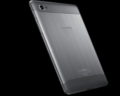</a>

</td>

<td valign="top">
I got mine for $645.50 from Amazon Market Vendor “<a href="https://www.amazon.com/gp/aag/main?ie=UTF8&isAmazonFulfilled=0&marketplaceID=ATVPDKIKX0DER&isCBA=&asin=&seller=A2DF5A0I30XI6G" target="_blank">Transformersandgsmphones</a>” … it shipped very fast and was a brand new unit. Caveat: From what I understand, units purchased through grey market like this will be difficult if not impossible to submit for any warranty claim.
</td>
</tr>

<tr>
<td valign="top">

  AmazonBasics Stylus  <a href="https://www.amazon.com/gp/product/B004GCJEZU" target="_blank">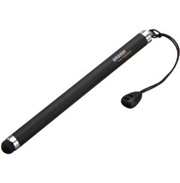</a>

</td>

<td valign="top">
<ul>
  <li>
    $11 from Amazon
  <li>
    Highly reviewed
  <li>
    Soft tip seems bulbous at first but in actual tablet usage turns out to be very appropriate. Still, I think I would really like the pressure sensitive line thickness capability of the Note models’ smart pen.
  </li>
</ul>
</td>
</tr>
<tr>
<td valign="top">

  SanDisk 64GB microSD card<a href="https://www.amazon.com/gp/product/B005V7WIA2" target="_blank">  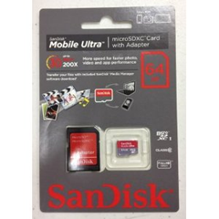</a>

</td>

<td valign="top">
<ul>
  <li>
    class 6 but speedy enough
  <li>
    it actually works
  <li>
    7.7 formats it as fat32/vfat by default… there are some tools for getting it mounted as NTFS, IFF you think you need >4GB files… I found the tools not working right away and think I’ll be fine on fat32.
  <li>
    Got mine for $119 @ Amazon but that price is dropping almost daily! hold out as long as you can!
  </li>
</ul>
</td>
</tr>
<tr>
<td valign="top">

  RAM-Mounts Cradle  (RAM-HOL-TAB-SMU)<a href="https://www.gpscity.com/ram-mount-universal-tablet-mount-small-tab-tite-cradle-ram-hol-tab-smu.html" target="_blank">  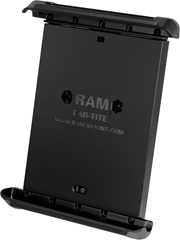</a> <a href="https://www.gpscity.com/ram-mount-strap-rail-base-with-standard-arm-diamond-assembly.html" target="_blank"> 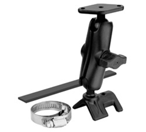</a>

</td>

<td valign="top">
<ul>
  <li>
    I love RAM-Mounts and this is the absolute *PERFECT* fit for the GTab 7.7 in scenarios like bicycle handlebars.
  <li>
    The middle sized cup is a very satisfying fit for the GTab 7.7.
  <li>
    It will work great with a rubber case or naked. The grip spring is very strong. I bounced along a VERY bumpy 8 hour bike ride recently and there is no way the tablet is coming loose.
  <li>
    $28 from GPSCity
  <li>
    For bike handlebars I recommend pairing the cradle with this <a href="https://www.gpscity.com/ram-mount-strap-rail-base-with-standard-arm-diamond-assembly.html" target="_blank">RAM kit comprised of a “strap rail base”, medium arm and diamond plate</a>.
  <li>
    <a href="/images/uploads/2012/samsung-galaxy-tab-77-p6800-2b706c0feee1.jpg">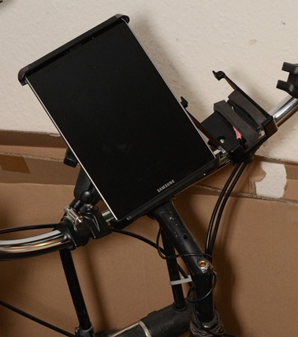</a>
  </li>
</ul>
</td>
</tr>
<tr>
<td valign="top">

  Sea to Summit Waterproof TPU Case  <a href="https://www.amazon.com/gp/product/B003IVJN6A" target="_blank">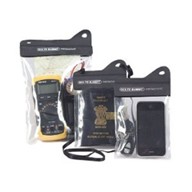</a>

  <a href="https://www.amazon.com/gp/product/B000UDBMZE" target="_blank">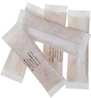</a>

</td>

<td valign="top">
<ul>
  <li>
    Make sure you get the LARGE version… it’s a nice fit for the tab 7.7
  <li>
    I’m using it in tandem with the RAM-Mount cradle above and it does fit. The extra material at the top is kind of crammed in there and there’s a bit of bowing in the plastic surface.. but the touch screen works fine.
  <li>
    Honestly, depending on how often you plan on needing that sort of thing you might just get by with a new heavy Ziploc bag each ride… hi-ho landfill! 🙂
  <li>
    I went ahead and got some <a href="https://en.wikipedia.org/wiki/Desiccant" target="_blank">Desiccant</a> packs while I was at it just in case… you may have some in an old shoe box or something
  <li>
    $20 @ Amazon
  </li>
</ul>
</td>
</tr>
<tr>
<td valign="top">

  Samsung OEM “Book Cover” Case

  

</td>

<td valign="top">
<ul>
  <li>
    A bit pricey around $40 street and often out of stock
  <li>
    I definitely like how this fits into day-to-day usage
  <li>
    it’s thin, light, hard shell, unbreakable kind of plastic
  <li>
    tab snaps into stiffer corners so it won’t fall out
  <li>
    there is some corner drop protection… not extensive rubber pads, but some extra shock absorption plastic there on the corners.
  <li>
    there is rubber on two edges so theoretically you could stand it up in landscape mode but I have found that the angle where it will stand up without sliding back down flat is not really conducive to real usage… one would have to rig something behind it to block it from sliding.
  </li>
</ul>
</td>
</tr>
<tr>
<td valign="top">

  “OTG” USB Host Adapter  <a href="https://www.amazon.com/gp/product/B005YWIRBS" target="_blank">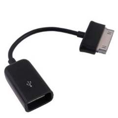</a>

</td>

<td valign="top">
<ul>
  <li>
    <a href="https://en.wikipedia.org/wiki/USB_On-The-Go" target="_blank">OTG = On The Go</a>… apparently it’s a standard that allows for swapping the master-slave role … not sure why that helps since we’d want the tab to be the host in all scenarios I can think of… flash drive, hard drive, keyboard, etc.
  <li>
    $6.70 @ Amazon
  <li>
    See <a href="https://www.blogger.com/blogger.g?blogID=7726907200224433699#otgmounter">USB Mass Storage Watcher</a> in the apps section below.
  <li>
    No surprise, the tab couldn’t power a 2.5” USB HDD.
  </li>
</ul>
</td>
</tr>
<tr>
<td valign="top">

  USB Charge Adapter (aka “Filter Plug”)  <a href="https://www.amazon.com/dp/B007IXBTCK/ref=pe_175190_21431760_cs_sce_3p_dp_1">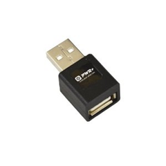</a>

</td>

<td valign="top">
<ul>
  <li>
    This little bugger takes some explaining… the nutshell is that some of these devices like the gtab are checking for a special USB pin configuration to take a charge from a USB connection.
  <li>
    This is an example thread to <a href="https://forum.xda-developers.com/showthread.php?t=1473084" target="_blank">get some more background</a>… including self hacked cables.
  <li>
    The other thing to be aware of is that the stock AC charger pumps 2.1Amps… so if you go with another source (e.g. external batt), then you want to shoot for that higher amperage to ensure the fastest charging… see “<a href="https://www.blogger.com/blogger.g?blogID=7726907200224433699#extbatt">External Battery</a>” section below,several units are addressing this requirement now.
  <li>
    Got mine on <a href="https://www.amazon.com/dp/B007IXBTCK/ref=pe_175190_21431760_cs_sce_3p_dp_1" target="_blank">Amazon for $5.90 + $5.50 shipping</a> (gip)
  <li>
    They go for super cheap on <a href="https://cgi.ebay.com/USB-car-wall-charger-adapter-plug-Samsung-Galaxy-TAB-/190522553195?pt=US_Tablet_Accessories&hash=item2c5c07736b#ht_3085wt_1163" target="_blank">eBay</a> and <a href="https://www.dealextreme.com/p/usb-power-adapter-for-samsung-p1000-81753" target="_blank">DealExtreme</a>
  </li>
</ul>
</td>
</tr>
<tr>
<td valign="top">

  External Battery  PowerTraveler PowerMonkey eXtreme

  <a href="https://powertraveller.com/iwantsome/primatepower/powermonkeyextreme/" target="_blank">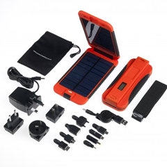</a>

</td>

<td valign="top">
<ul>
  <li>
    I wound up getting a yellow model for $180… it’s smaller than I thought it would be (which is great). Very light and portable. I like the overall package even if it is a little too pricey. I honestly haven’t used it much at all since my whole paradigm shifted once we left Germany and moved to Seattle. Hopefully this will all swing back into normalcy once we get moved into our new money pit and can hit the trails in a camper with the kiddos.
  <li>
    <a href="https://richard.mackney.com/powermonkey-extreme-mobile-power-review/" target="_blank">review</a>
  <li>
    $190
  <li>
    9000Mah
  <li>
    2.1A USB with a pigtail
  <li>
    242 grams
  <li>
    AUTO-OFF
  <li>
    completely WATERPROOF
  <li>
    comes with a CASE, lots of tips & outlet adapters
  <li>
    does NOT come with the required USB adapter for the gtabs; see <a href="https://www.blogger.com/blogger.g?blogID=7726907200224433699#usbcharge">USB charge adapter</a> above. PowerTraveler does sell their own version of this adapter.
  </li>
</ul>

  Alternatives:

<ul>
  <li>
    <a href="https://www.tekkeon.com/productcart/pc/viewPrd.asp?idcategory=9&idproduct=22" target="_blank">Tekkeon MP3450 R3</a> – $160, 2.1A USB, 50Wh = 10,000 mAh @ 5v, *15.3 oz* (433 grams)
  <li>
    &nbsp;<a href="https://www.phonesuit.com/primo-power-core-battery-pack-for-tablets-phones/" target="_blank">PhoneSuit Primo Power Core</a> Battery Pack &#8211; <a href="https://www.androidpolice.com/2011/08/06/deep-review-primo-power-core-8200-mah-portable-battery-pack-juice-when-you-need-it-and-a-whole-lot-of-it/" target="_blank">review</a>, 8200 mAh, 2.1 Amps USB (see amperage notes on USB Filter Plug above), 233 g / 8.2 oz, , <a href="https://www.google.com/products/catalog?q=PhoneSuit+Primo+Power+Core&cid=6736635945410225469#scoring=p" target="_blank">$100</a>&nbsp; (cons: no auto-off)
  </li>
</ul>
</td>
</tr>
<tr>
<td valign="top">

  Bluetooth Keyboards  Think Outside/Sierra Stowaway AND AmazonBasics model  <a href="https://www.amazon.com/Think-Outside-SBT5ER-Stowaway-Bluetooth/dp/B000FG44BA" target="_blank">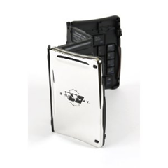</a><a href="/images/uploads/2012/samsung-galaxy-tab-77-p6800-fa13a90cc5a3.png">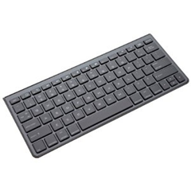</a>

</td>

<td valign="top">
<ul>
  <li>
    Foldup styles: <ul>
      <li>
        Long since discontinued, the <a href="https://www.amazon.com/Think-Outside-SBT5ER-Stowaway-Bluetooth/dp/B000FG44BA" target="_blank">Think Outside</a> is slick, fragile, but very slick… the key feel is great and the outside snaps shut into a cool shiny, chrome case… they’re experiencing a funny price spike circa Q1 2012, going for $250 on Amazon is crazy… this thing probably retailed for $100… I got mine for $65 on eBay a couple years back… there is another <a href="https://www.amazon.com/Stowaway-Ultra-Slim-Bluetooth-Keyboard-Handhelds/dp/B0002OKCXE/ref=dp_cp_ob_e_title_1" target="_blank">Stowaway model &#8211; iGo Ultra Slim</a> that only folds once and seems practical as well.
      <li>
        <a href="https://www.nomadstore.net/#%21nomad-keyboard" target="_blank">Nomad Mobile</a> has a good rendition of another common style single fold … these go for <a href="https://www.amazon.com/Bluetooth-Folding-KeyBoard-BlackBerry-Android/dp/B002ZNIWJ6/ref=pd_cp_e_1" target="_blank">cheaper elsewhere</a>.
      </li>
    </ul>
  <li>
    Non-foldable: <ul>
      <li>
        The <a href="https://www.apple.com/keyboard/" target="_blank">Apple Bluetooth Keyboard</a> is the gold standard really... razor thin, aluminum, awesome feel to the keys. <ul>
          <li>
            one catch, no friggin delete key... there's a backspace but no "forward" delete, you have to hit FN-Backspace to get forward delete.
          <li>
            also, no true numpad but that's sort of what you want in a portable anyway.
          </li>
        </ul>
      <li>
        I noticed <a href="https://www.amazon.com/AmazonBasics-Bluetooth-Keyboard-Apple-iPhone/dp/B005EOWBKE" target="_blank">Amazon has a nice knockoff of the Apple style</a> now. <ul>
          <li>
            It has a delete key and there's a customer image that shows it's actually a tad shorter than the Apple.
          </li>
        </ul>

      <li>
        <a href="www.logitech.com/en-us/tablet-accessories/keyboards/devices/tablet-keyboard-android" target="_blank">Logitech</a> has a polished looking tablet keyboard option with integrated case/stand now too: 

          &nbsp;&nbsp;&nbsp;&nbsp; <a href="www.logitech.com/en-us/tablet-accessories/keyboards/devices/tablet-keyboard-android" target="_blank">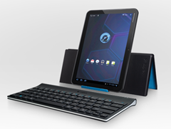</a>
      </li>
    </ul>
  </li>
</ul>
</td>
</tr>

<tr>
<td valign="top">

  Media / Charging Dock 

  

    <a href="https://www.samsung.com/us/mobile/galaxy-tab-accessories/EDD-D1E3BEGSTA" target="_blank">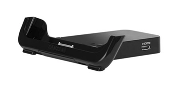</a>

</td>

<td valign="top">
<ul>
  <li>
    

      Has HDMI but it’s annoyingly the mini version invariably requiring more hanging adapter bulk 🙁
    

  <li>
    

      Also has headphone audio out if you need it.
    

  <li>
    

      The usual plastic quality build, basically works but feels kind of wobbly when you insert.
    

  <li>
    

      I’d give this a mild recommendation… didn’t see anything else as a worthy challenger at the time.
    

  </li>
</ul>
</td>
</tr>

<tr>
<td valign="top">

  Zephyr HxM &#8211; Bluetooth Heart Rate Monitor 

  

    <a href="https://www.amazon.com/Zephyr-HxM-Delivers-BlackBerry-Smartphones/dp/B002PL33AQ" target="_blank">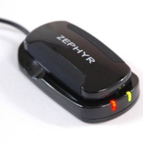</a>

</td>

<td valign="top">
<ul>
  <li>
    You can also go with a Nike+ wireless protocol, <a href="https://www.amazon.com/gp/product/B003U6HAJ0/ref=pd_lpo_k2_dp_sr_2?pf_rd_p=486539851&pf_rd_s=lpo-top-stripe-1&pf_rd_t=201&pf_rd_i=B002PL33AQ&pf_rd_m=ATVPDKIKX0DER&pf_rd_r=1KQ4GFE0KSWV3YXWH7KX" target="_blank">Polar makes a Nike+</a>.
  <li>
    or there’s the more open ANT+ protocol, for which <a href="https://www.amazon.com/Garmin-Premium-Heart-Monitor-Strap/dp/B0029M3NSS/ref=sr_1_1?ie=UTF8&qid=1333730894&sr=8-1" target="_blank">Garmin has a couple ANT+ monitors</a> and are the cheapest… ANT+ sounds reliable but,
  <li>
    I went with Bluetooth to avoid the need for an ANT+ dongle… some phones are starting to include this radio natively.
  <li>
    Bluetooth options are slim, <a href="https://www.amazon.com/Zephyr-HxM-Delivers-BlackBerry-Smartphones/dp/B002PL33AQ" target="_blank">the Zephyr seemed to review better</a> than the <a href="https://www.amazon.com/Polar-Wearlink-Transmitter-With-Bluetooth/dp/B004HM0H14/ref=sr_1_2?ie=UTF8&qid=1333730829&sr=8-2" target="_blank">Polar Bluetooth</a>.
  <li>
    Amazon wasn’t stocked so I ordered from <a href="https://store.endomondo.com/us/zephyr-hxm-heart-rate-monitor.html" target="_blank">Endomondo for $75 bones</a> (ouchy)
  <li>
    Pairing worked as instructed, showed up right away in the Endomondo sports tracking app and reported numbers similar to my arm band blood pressure monitor.
  </li>
</ul>

  <a href="https://endomondo.helpserve.com/index.php?_m=knowledgebase&_a=viewarticle&kbarticleid=28" target="_blank">Pairing Instructions</a>:

<ol>
  <li>
    

      Make sure it’s fully charged, plugged to the strap, the strap pads have to be pretty wet & you have to put it on
    

  <li>
    

      Do normal Android bluetooth pairing; code: 1234
    

  <li>
    

      Then go into the Endomondo app > Settings > Accessory Settings > Connect To Sensors > Scan
    

  </li>
</ol>
</td>
</tr>

<tr>
<td valign="top">

  Mujjo Capacitive Gloves  <a href="https://store.endomondo.com/us/mujjo-touchscreen-gloves-1.html" target="_blank">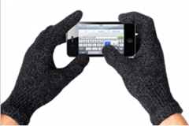</a>

</td>

<td valign="top">
<ul>
  <li>
    Couldn’t resist springing for these while I was at the <a href="https://store.endomondo.com/us/mujjo-touchscreen-gloves-1.html" target="_blank">Endomondo store – $35</a> … kinda pricey
  <li>
    They work… Angry Birds is playable, I wouldn’t want to type with them though… I got the Male M/L size… I would say my hands are medium and there’s just a bit of extra length to the fingers… with normal gloves I wouldn’t care but it obviously matters for touch screen precision… if you have small hands, consider the women’s size… they are very stretchy material.
  </li>
</ul>
</td>
</tr>
<tr>
<td style="padding-bottom: 20px; padding-top: 40px" valign="top" colspan="2">

  Not Recommended

</td>
</tr>

<tr>
<td valign="top">

  Motorola S10-HD Bluetooth Stereo Headphones with Microphone  <a href="https://www.amazon.com/gp/product/B004BHCSQC" target="_blank">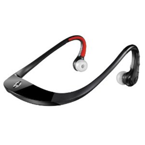</a>

</td>

<td valign="top">
<ul>
  <li>
    $60 @ Amazon
  <li>
    too expensive in my opinion
  <li>
    the headphone sound is “OK”
  <li>
    the microphone sound quality is pretty bad
  <li>
    they’re really tight on my ears with my fat head and the design just makes them that way with no relief … I basically hate these and wish I never got them at this point… anybody want a deal on a completely unused pair?
  <li>
    all the buttons you’d want… volume and pause/play, fwd/rev and probably a call hang-up
  </li>
</ul>
</td>
</tr>
<tr>
<td valign="top">

  Case Logic LNEO-7 7-Inch Sleeve  <a href="https://www.amazon.com/gp/product/B004CJ8DKE" target="_blank">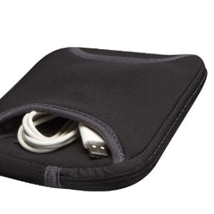</a>

</td>

<td valign="top">
<ul>
  <li>
    Update 2012-07-4: I wound up going with the OEM Samsung “Book Cover” case and haven’t looked back. See those comments above.
  <li>
    It’s “OK”… fits pretty well…just a little snug around the corners but not bad
  <li>
    no room for much of anything in the cramped pouch… the USB cable and a pigtail would be about max.
  <li>
    <a href="https://www.amazon.com/gp/product/B004CJ8DKE" target="_blank">Can’t lose for $14.50 @ Amazon</a>
  </li>
</ul>
</td>
</tr>
<tr>
<td valign="top">

  Armor Suit &#8211; Screen Protector <a href="https://www.amazon.com/gp/product/B006WFUH64" target="_blank"> 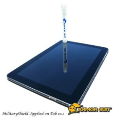</a>

</td>

<td valign="top">
<ul>
  <li>
    This one looked good to me because it has a liquid approach to ironing out the bubbles … update 2012-07-04: the spray bottle solution was a good trick, I still got dust in there but that’s hard to avoid.
  <li>
    I paid $17 + shipping @ Amazon and it’s already down to $10… feeling a bit gipped 🙂
  <li>
    After I got the Samsung Book Cover case (see above), I ditched the screen protector, feeling that it took away from the display a bit and the case is plenty of scratch protection during transit which was my personal biggest concern… this is definitely personal preference area.
  </li>
</ul>
</td>
</tr>
<tr>
<td style="padding-bottom: 20px; padding-top: 40px" valign="top" colspan="2">

  Wish List

</td>
</tr>

<tr>
<td valign="top">

  Keyboard Stands & Charging Docks  Incase Origami Workstation for Apple Wireless Keyboard 

  

    <a href="https://goincase.com/products/detail/origami-workstation-cl57934" target="_blank">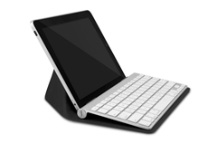</a>

</td>

<td valign="top">
<ul>
  <li>
    Haven’t found anything perfect yet… everything is missing something... at the moment, a makeshift cardboard stand with the charge/usb cables is working better than I expected.
  <li>
    <a href="https://www.samsung.com/us/mobile/galaxy-tab-accessories/EKD-K18AWEGSTA" target="_blank">Samsung’s keyboard dock</a> &#8211; doesn’t have HDMI port
  <li>
    Also just considering a case/stand for my Apple Bluetooth keyboard – <a href="https://goincase.com/products/detail/origami-workstation-cl57934" target="_blank">Incase Origami Workstation</a>: <a href="https://www.youtube.com/watch?v=1UsnGxXqVdk" target="_blank">demos <i>ok</i></a>, not great
  </li>
</ul>
</td>
</tr> </tbody>
</table>

### Recommended Apps:

<table style="border-collapse: collapse" cellspacing="0" cellpadding="2" border="1">
<tr>
<td valign="top">

  App Name

</td>

<td valign="top">

  Notes

</td>
</tr>

<tr>
<td valign="top">
<a href="https://forum.xda-developers.com/attachment.php?attachmentid=863784&d=1327012004" target="_blank">root.zip</a> (free)  (gtab 7.7 specific)
</td>

<td valign="top">
<a href="https://www.androidauthority.com/galaxy-tab-7-7-root-52945/" target="_blank">rooting instructions</a>
</td>
</tr>

<tr>
<td valign="top">
<a href="https://play.google.com/store/apps/details?id=stericson.busybox&hl=en" target="_blank">BusyBox</a> (free)
</td>

<td valign="top">
Loads grep, awk and ash (shell)
</td>
</tr>

<tr>
<td valign="top">
<a href="https://play.google.com/store/apps/details?id=com.noshufou.android.su" target="_blank">SuperUser</a> (free)
</td>

<td valign="top">
Everything cool requires it
</td>
</tr>

<tr>
<td valign="top">
<a href="https://play.google.com/store/apps/details?id=jackpal.androidterm" target="_blank">Android Terminal Emulator</a> by Jack Palevich (free)
</td>

<td valign="top">
<ul>
  <li>
    Make ash (from BusyBox) the default shell: /system/xbin/ash –
  <li>
    Make this the initial command to be su by default: su –c /system/xbin/ash
  </li>
</ul>
</td>
</tr>
<tr>
<td valign="top">
<a href="https://play.google.com/store/apps/details?id=com.speedsoftware.rootexplorer" target="_blank">Root Explorer</a> ($$)
</td>

<td valign="top">
Has a nice and easy “mount as R/W” button.
</td>
</tr>

<tr>
<td valign="top">
<a href="https://play.google.com/store/apps/details?id=com.estrongs.android.pop" target="_blank">ES File Explorer</a> (free)
</td>

<td valign="top">
Does everything in one shot… nice icons, *fast* SMB client (Windows File Sharing), FTP client, built in text editor, image viewer, even movie player
</td>
</tr>

<tr>
<td valign="top">
<a href="https://forum.xda-developers.com/attachment.php?attachmentid=905219&d=1329436786" name="NtfsSd" target="_blank">NtfsSd</a> (gtab 7.7 specific)
</td>

<td valign="top">
<ul>
  <li>
    <a href="https://forum.xda-developers.com/showthread.php?t=1493294&page=2" target="_blank">Found in this xda-dev thread</a>; mounts your NTFS formatted external sdcard in the native path (/mnt/sdcard/extStorages/SdCard) which is a bit of trick… main advantage for me is that external SDCard shows show up in Explorer when USB connected to PC; other NTFS mounting approaches (e.g. Drive Mount) were not showing SDCard on PC.
  <li>
    Symbolic links don’t work to fat32/exFat/vfat hence why NtfsSd is doing an interesting trick of some sort.
  <li>
    There is a native linux command for mapping external filesystems (i.e. a FAT drive) to internal paths but it doesn’t hold up across reboots which becomes more of a pain than you’d initially think. <ul>
      <li>
        mkdir /mnt/sdcard/extStorages/SdCard/Music
      <li>
        mount -o bind /mnt/sdcard/extStorages/SdCard/Music /mnt/sdcard/Music
      </li>
    </ul>
  </li>
</ul>
</td>
</tr>

<tr>
<td valign="top">
<a href="https://play.google.com/store/apps/details?id=com.skidmrk.umswatcherotg" target="_blank">USB Mass Storage Watcher OTG</a> (free) (by Skidmrk)
</td>

<td valign="top">
Mounted my 2.5” USB NTFS HDD via the <a href="https://www.blogger.com/blogger.g?blogID=7726907200224433699#otgadapter">OTG USB pigtail</a> just fine (the HDD required external power).
</td>
</tr>

<tr>
<td valign="top">
<a href="https://play.google.com/store/apps/details?id=net.osmand.plus" target="_blank">OsmAnd</a> (free, but buy it)
</td>

<td valign="top">
This really makes my day… Open Street Maps (OSM) with the Open Cycle Maps (OCM) layer is the bees knees… this App readily downloads the map tiles for whatever is currently displayed, with whatever zoom levels you choose and then you’re ready to go off-road/offline… couldn’t be easier… it even does offline routing!!
</td>
</tr>

<tr>
<td valign="top">
<a href="https://play.google.com/store/apps/details?id=com.evernote" target="_blank">Evernote</a>
</td>

<td valign="top">
Skitch and all the integration on a mobile device is pretty killer.
</td>
</tr>

<tr>
<td valign="top">
<a href="https://play.google.com/store/apps/details?id=net.dinglisch.android.taskerm" target="_blank">Tasker</a>, <a href="https://play.google.com/store/apps/details?id=de.elmicha.app.LocaleExecute" target="_blank">Locale Execute Plug-In</a>
</td>

<td valign="top">
I came across this as a way to <a href="https://forum.xda-developers.com/showpost.php?p=14740432&postcount=6" target="_blank">re-run mount commands after each reboot</a> (see <a href="https://www.blogger.com/blogger.g?blogID=7726907200224433699#mount">“mount –o bind”</a> notes above).
</td>
</tr>

<tr>
<td valign="top">
<strike>doubleTwist (free) + AirSync ($$)</strike>
</td>

<td valign="top">
It basically works but I punted… The issues I have are probably mostly related to the still settling Android SDCard ecosystem.
</td>
</tr>

<tr>
<td valign="top">
<a href="https://play.google.com/store/apps/details?id=com.parkvu.android.music.withme" target="_blank">Music WithMe</a> (free)
</td>

<td valign="top">
Currently trying this as my iTunes sync’er after doubleTwist (DT) would only see internal storage Music folder… Tasker + Execute + bind mount (above) probably would've bridged that gap but Music WithMe (MWM) has a simple music storage path setting, looks promising. MWM seems to report its sync status more robustly than DT. MWM integrates through FaceBook so you get into sharing what you're listening to and what friends are listening to. I'll check that out if the basics pan out.
</td>
</tr></tbody>
</table>