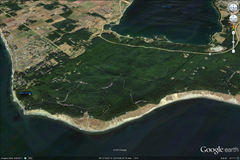
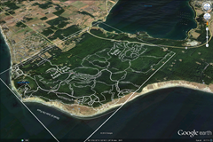

## Nutshell

Start with a raw PDF/PNG/JPG trail map and load into mobile Google Earth (GE) to provide live GPS tracking while you're hiking the trails.

## Basic tools to obtain:

  * A "KMZ Builder" ([Android][1]) - to convert raw image into a KMZ file. The primary task here is mapping specific pixel points on the image to their real life lat/long (aka [Georeference][2]). The easiest freebie I've found so far is Google's tool for Android. It sounds like [ArcGIS][3] also provides this capability but that's a fat commercial PC package.
  * A "KMZ Loader" ([Android][4], [iOS][5] ) – for whatever idiotic reason, current versions of mobile GE only load KML's not KMZ's. Windows GE actually does load KMZ's directly so maybe there's hope this will fall away in future revisions. Annoyingly, GE will only retrieve these suckers from a web URL, not a local file. The Android app fires up a mini web server to provide the KML how GE wants it. 
      * KMZ's are convenient in that they carry both the KML data as well as the map image file together in a bundle. The bundle is common zip format; So if you're curious about the contents, simply rename to .zip and drill in.
      * KML is simple xml describing pertinent info like the lat/long points and an href to the image file.

## Background

We're new to Seattle after being spoiled in Germany where detailed digital trail maps were readily available... presumably there are numerous trails everywhere but I'm not finding much logged in the usual products (Google maps, Garmin, Open Street Maps).

However there does seem to be decent trail coverage provided from PDF/image based trail maps on all the various fed & state .gov sites. Typically the same that is posted at the trail head. It's frustrating that these raw image maps were probably generated from a digital geo accurate source... if only all those tax dollars at work could yield more accessible information... this approach doesn't result in a perfect match but it's a decent option above nothing at all.

## Steps (using Photoshop)

  1. Mainly we need to "cut out" the background leaving only the trail lines on a transparent background. This way the GE satellite imagery will show through our trail overlay - Use the Select > Color Range menu, hit the background color of your map with the eye dropper and play with the "fuzziness" slider. You'll get all of the background selected to where you can hit <kbd>CTRL+X</kbd> to delete it, leaving the trails freestanding on transparency
  2. <kbd>CTRL+SHIFT+I</kbd> to invert the selection to only the trails and then 
  3. Image > Adjustments > Replace Color to flip the lines from black to white to make them stand out when overlayed onto the generally darker colors of GE map. 
  4. save as PNG file format
  5. finally, load into your preferred KZM Loader (referenced above)

Here's an [example KMZ]({{ site.baseurl }}/downloads/Fort_Ebey_Kettles_Park.kmz) I've slapped together from [this source PDF][7]. It's not perfectly lined up and I couldn't really reach perfection.

If you load [GE][8] on your PC, you'll be able to double click this file to see what I'm saying. It all rotates in 3D and even gets "clamped" to the terrain! From what I can tell, once mobile GE has cached the map tiles for your desired area, you can count on it displaying even while offline on the trail.

Before  With Map  

 [1]: https://play.google.com/store/apps/details?id=com.custommapsapp.android&feature=search_result#?t=W251bGwsMSwxLDEsImNvbS5jdXN0b21tYXBzYXBwLmFuZHJvaWQiXQ..
 [2]: https://en.wikipedia.org/wiki/Georeference
 [3]: https://www.esri.com/software/arcgis
 [4]: https://play.google.com/store/apps/details?id=com.appspot.wrightrocket.kmlkmz&feature=search_result#?t=W251bGwsMSwyLDEsImNvbS5hcHBzcG90LndyaWdodHJvY2tldC5rbWxrbXoiXQ..
 [5]: https://itunes.apple.com/us/app/kmz-loader/id435350230?mt=8
 [7]: https://www.islandcounty.net/publicworks/Documents/Kettles%20trails%202015.pdf
 [8]: https://www.google.com/earth/download/ge/agree.html
