<table border="1" cellpadding="2" cellspacing="0">
  <tr>
    <td valign="top">
      “SQL Server Transport Encryption” is a good Google phrase for this technology.  Reference: <a href="https://msdn.microsoft.com/en-us/library/ms191192.aspx" title="https://msdn.microsoft.com/en-us/library/ms191192.aspx">https://msdn.microsoft.com/en-us/library/ms191192.aspx</a>
    </td>
    
    <td valign="top">
    </td>
  </tr>
  
  <tr>
    <td valign="top">
      <h4>
        Obtain an SSL Certificate
      </h4>
      
      

        A self signed certificate is easy and works fine... here’s one way:
      

      
      <ul>
        <li>
          Get the IIS 6.0 Resource Kit Tools: <a href="https://www.microsoft.com/download/en/confirmation.aspx?id=17275">https://www.microsoft.com/download/en/confirmation.aspx?id=17275</a>
        </li>
        <li>
          All you'll need is the "SelfSSL.exe" tool so the custom install is minimal.
        </li>
        <li>
          Find SelfSSL.exe in default install path: C:Program FilesIIS Resources
        </li>
        <li>
          Good reference for SelfSSL usage: <a href="https://www.sslshopper.com/article-how-to-create-a-self-signed-certificate-in-iis-7.html">https://www.sslshopper.com/article-how-to-create-a-self-signed-certificate-in-iis-7.html</a>, scroll down to "Generate a Self Signed Certificate with the Correct Common Name"
        </li>
        <li>
          Command line example: 

            

              

                <ol style="background: #1e1e1e; margin: 0; padding: 0 0 0 5px; white-space: nowrap;">
                  <li>
                    SelfSSL /N:CN=MWR-TRO-V2 /V:1999999
                  </li>
                </ol>
              

            

          

          
          <ul>
            <li>
              The /V: part is the validity duration of your cert, in days. I believe 1999999 is the max, which corresponds to around 5475 years in the future (that ought'a last ya ;)
            </li>
            <li>
              The /N:CN= part is the “Common Name” this cert will be tied to… in this case that needs to be the true machine name of your database server.
            </li>
          </ul>
        </li>
        
        <li>
          “Do you want to replace the SSL settings for site 1 (Y/N)?” => No
        </li>
        <li>
          Now you have a cert registered in your “personal certificate store” &#8211; next we’ll extract it for installation on db server.
        </li>
      </ul>
    </td>
    
    <td valign="top">
    </td>
  </tr>
  
  <tr>
    <td valign="top">
      Fire up the MMC “Certificates Console” to manage your new cert 
 
      
      <ul>
        <li>
          Good reference: <a href="https://support.microsoft.com/kb/276553)">https://support.microsoft.com/kb/276553)</a>
        </li>
        <li>
          Open the MMC console: Start > Run > mmc [enter] (or Windows-R) (MMC Fig.1)
        </li>
        <li>
          Add the cert snapin: click File > Add/Remove Snap-in (MMC Fig.2)
        </li>
        <li>
          select Certificates under Available snap-ins… and hit Add button… (MMC Fig.3)
        </li>
        <li>
          select Computer Account… then Next… (MMC Fig.4)
        </li>
        <li>
          select Local computer, and then Finish… (MMC Fig.5)
        </li>
        <li>
          lastly, hit OK (MMC Fig.6)
        </li>
      </ul>
      
      <ul>
        <li>
          You may wish to save this MMC configuration for future convenience (MMC Fig.7)
        </li>
      </ul>
    </td>
    
    <td valign="top">
      Screenshots...
 
      
      

        

          <a href="/images/uploads/2013/enable-ssl-connections-to-sql-server-214fdca2f4c4.png" rel="thumbnail" title="MMC Fig.1">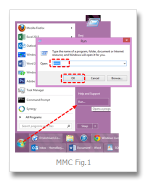</a>
        

        
        

          <a href="/images/uploads/2013/enable-ssl-connections-to-sql-server-9f8d8b939f4b.png" rel="thumbnail" title="MMC Fig.1">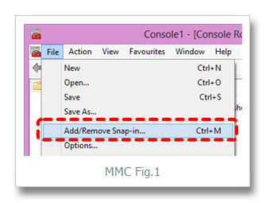</a>
        

        
        

          <a href="/images/uploads/2013/enable-ssl-connections-to-sql-server-55d4e629d776.png" rel="thumbnail" title="MMC Fig.3">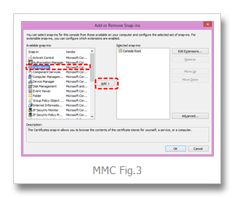</a>
        

        
        

          <a href="/images/uploads/2013/enable-ssl-connections-to-sql-server-5bad7005c868.png" rel="thumbnail" title="MMC Fig.4">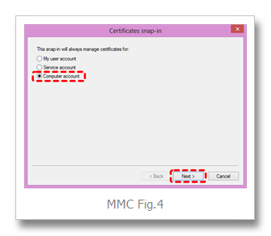</a>
        

        
        

          <a href="/images/uploads/2013/enable-ssl-connections-to-sql-server-854e695222ce.png" rel="thumbnail" title="MMC Fig.5">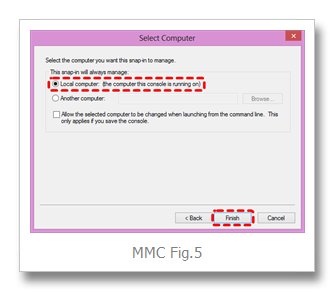</a>
        

        
        

          <a href="/images/uploads/2013/enable-ssl-connections-to-sql-server-c583879a7f9a.png" rel="thumbnail" title="MMC Fig.6">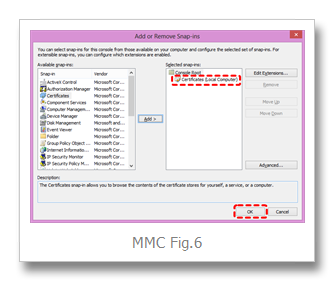</a>
        

        
        

          <a href="/images/uploads/2013/enable-ssl-connections-to-sql-server-5cb5c3fea9ac.png" rel="thumbnail" title="MMC Fig.7">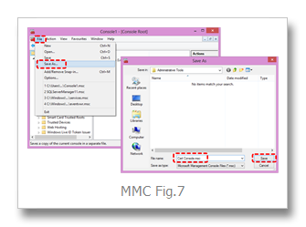</a>
        

      

    </td>
  </tr>
  
  <tr>
    <td valign="top">
      <h4>
        Export the cert as a pfx file
      </h4>
      
      

        …to be installed on your database server
      

      
      <ul>
        <li>
          Certs installed via the above process will be your "Personal > Certificates" <em>folder</em> (Export Fig.1)
        </li>
        <li>
          Right mouse desired certifcate > All Tasks > Export > Next ... (Export Fig.2)
        </li>
        <li>
          “Export the private key?” => Yes … Next… (Export Fig.3)
        </li>
        <li>
          Select PFX format, "Include all certs...", "Export extended", NOT “Delete…”, Next … (Export Fig.4)
        </li>
        <li>
          Enter a password, hit Next… (Export Fig.5) – ** REMEMBER THAT PASSWORD **
        </li>
        <li>
          Save the pfx file (Export Fig.6)
        </li>
        <li>
          Finish… OK (Export Fig.7)
        </li>
      </ul>
    </td>
    
    <td valign="top">
      Screenshots...
 
      
      

        

          
        

        
        

          <a href="/images/uploads/2013/enable-ssl-connections-to-sql-server-c8f4a320ca30.png" rel="thumbnail" title="Export Fig.2">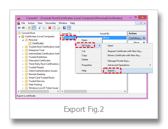</a>
        

        
        

          <a href="/images/uploads/2013/enable-ssl-connections-to-sql-server-a9b8a733aa02.png" rel="thumbnail" title="Export Fig.3">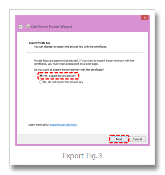</a>
        

        
        

          <a href="/images/uploads/2013/enable-ssl-connections-to-sql-server-e4d830b6b0a8.png" rel="thumbnail" title="Export Fig.4">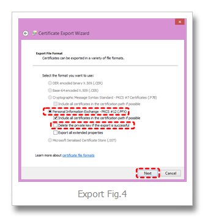</a>
        

        
        

          <a href="/images/uploads/2013/enable-ssl-connections-to-sql-server-3a69f566a246.png" rel="thumbnail" title="Export Fig.5">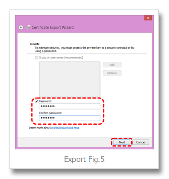</a>
        

        
        

          <a href="/images/uploads/2013/enable-ssl-connections-to-sql-server-9a86e0420309.png" rel="thumbnail" title="Export Fig.6">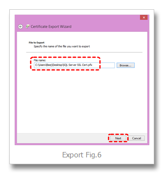</a>
        

        
        

          
        

      

    </td>
  </tr>
  
  <tr>
    <td valign="top">
      <h4>
        Import cert on database server
      </h4>
      
      <ul>
        <li>
          Login to your DB server desktop
        </li>
        <li>
          Launch MMC Cert Console same as above
        </li>
        <li>
          Go to Personal > Certs
        </li>
        <li>
          Right mouse All Tasks > "Import"… (Import Fig.1)
        </li>
        <li>
          Next… (Import Fig.2)
        </li>
        <li>
          Browse… (Import Fig.3)
        </li>
        <li>
          Next … (Import Fig.4)
        </li>
        <li>
          Enter Password, select “Mark this key as exportable”, Next… (Import Fig.5)
        </li>
        <li>
          “Place all certificates in the following store” => Personal… Next… (Import Fig.6)
        </li>
        <li>
          Finish (Import Fig.7)
        </li>
      </ul>
      
      <ul>
      </ul>
    </td>
    
    <td valign="top">
      Screenshots...
 
      
      

        

          <a href="/images/uploads/2013/enable-ssl-connections-to-sql-server-429ff39d5f58.png" rel="thumbnail" title="Import Fig.1">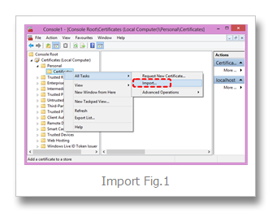</a>
        

        
        

          
        

        
        

          <a href="/images/uploads/2013/enable-ssl-connections-to-sql-server-1d2f840ad960.png" rel="thumbnail" title="Import Fig.3">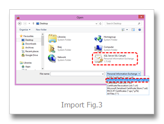</a>
        

        
        

          <a href="/images/uploads/2013/enable-ssl-connections-to-sql-server-9596e4f81864.png" rel="thumbnail" title="Import Fig.4">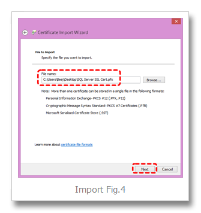</a>
        

        
        

          <a href="/images/uploads/2013/enable-ssl-connections-to-sql-server-85db0a4da817.png" rel="thumbnail" title="Import Fig.5">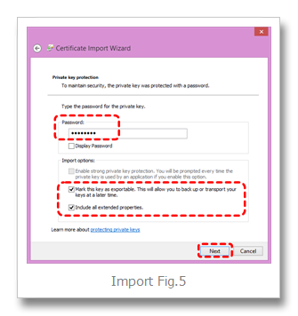</a>
        

        
        

          <a href="/images/uploads/2013/enable-ssl-connections-to-sql-server-3ee1cd109239.png" rel="thumbnail" title="Import Fig.6">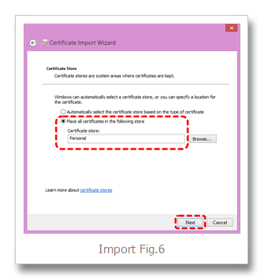</a>
        

        
        

          <a href="/images/uploads/2013/enable-ssl-connections-to-sql-server-a01e2c42d234.png" rel="thumbnail" title="Import Fig.7">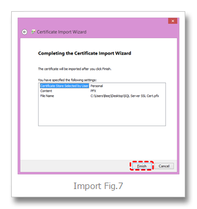</a>
        

      

    </td>
  </tr>
  
  <tr>
    <td valign="top">
      <h4>
        Activate SSL encryption on DB server
      </h4>
      
      <ul>
        <li>
          Fire up SQL Server’s Network Configuration Utility <ul>
            <li>
              Start&nbsp; > All Programs > Microsoft SQL Server {version} > Configuration Tools > SQL Server Configuration Manager"&nbsp;
            </li>
          </ul>
        </li>
        
        <li>
          then under "SQL Server Network Configuration"
        </li>
        <li>
          Right click "Protocols for MSSQLServer"
        </li>
        <li>
          select "Properties"
        </li>
        <li>
          set&nbsp; "Flags tab > Force Encryption" to Yes
        </li>
        <li>
          and select the installed cert on the "Certificates" tab
        </li>
        <li>
          voila!
        </li>
        <li>
          STOP AND RESTART THE SQL SERVER SERVICE
        </li>
        <li>
          login to the instance with an SSMS Query window
        </li>
        <li>
          fire this command to verify all connections are encrypted: 

            

              

                <ol style="background: #ffffff; margin: 0; padding: 0 0 0 5px; white-space: nowrap;">
                  <li>
                    SELECT encrypt_option, * FROM sys.dm_exec_connections WHERE session_id = @@SPID
                  </li>
                </ol>
              

            

          

        </li>
        
        <li>
          Tip: SP_WHO2 is handy for obtaining spids
        </li>
      </ul>
    </td>
    
    <td valign="top">
    </td>
  </tr>
</table>