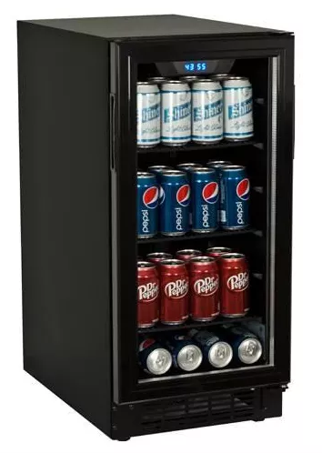
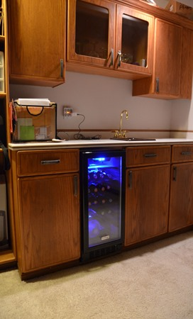
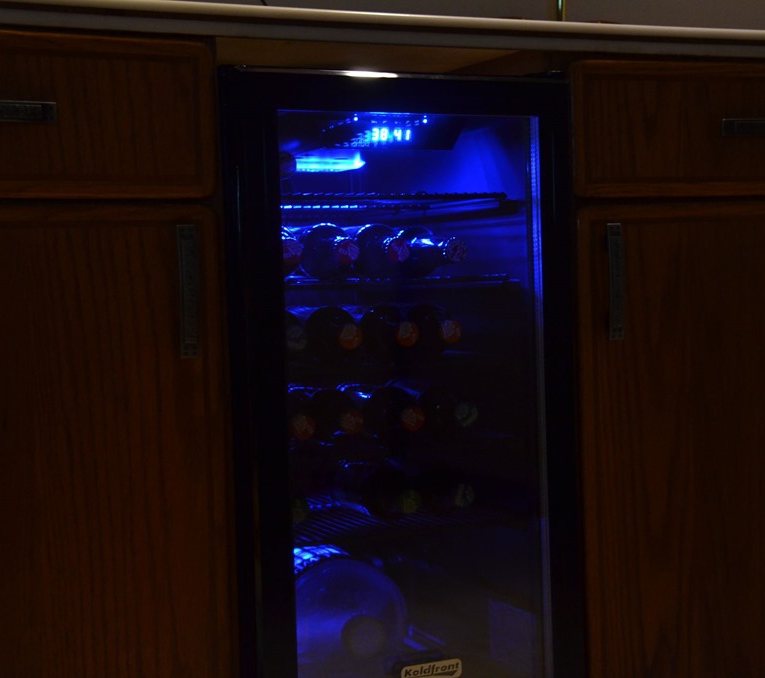

  * First one was a dud out of the box. Just didn't cool at all. EdgeStar support said it was missing coolant. Took them about 2 full weeks to turn around the replacement. They paid all replacement shipping via printed return label. It was a new serial number, not a repair of my old one, and it looked new. 
* I am very satisfied now with this second unit and would definitely recommend it. 
* The look is very nice. The glass is great. The blue light is great. 
* The size is great, very deep. Fit my under-the-bar-cabinet-slot really well. A little shorter than the broken down old "Scotsman" that was in there but nothing a couple 2x4's didn't fix. 
* Sure am glad to have found something in a more reasonable price range… I'm sure the Scotsman stuff must last forever but at upwards of $2k, not on my kids' college budget 🙂
* Cooling has been spot on for the 2 months I've had it so far &lt;knock wood&gt;.
* The cheapest I was able to find it was from <a href="https://www.idealwinecoolers.com/product/BBR900BL_Koldfront-80-Can-Black-Built-In-Locking-Beverage-Cooler" target="_blank">"Ideal Wine Coolers" for $400</a>. Half retail and $100 less than Amazon. 
* Other considerations for this same general form factor are the: 
* <a href="https://www.idealwinecoolers.com/product/CBR901SG_EdgeStar-94-Can-Silver-Trim-Built-In-Locking-Beverage-Cooler" target="_blank">"EdgeStar 80" (CBR901SG)</a> for <a href="https://www.idealwinecoolers.com/product/CBR901SG_EdgeStar-94-Can-Silver-Trim-Built-In-Locking-Beverage-Cooler" target="_blank">$500</a> if you're interested in the stainless steel look, and the 
* <a href="https://www.idealwinecoolers.com/product/OBR900SS_Edgestar-84-Can-Glass-Door-Outdoor-Stainless-Beverage-Cooler" target="_blank">"EdgeStar 84" (OBR900SS)</a> for <a href="https://www.idealwinecoolers.com/product/OBR900SS_Edgestar-84-Can-Glass-Door-Outdoor-Stainless-Beverage-Cooler" target="_blank">$750</a> if you want outdoor certified cooling capability[][1]… they indicate that a unit should be specifically designed to run outdoors or it will burn itself out quickly running non stop… that one would look great next to a hot tub 🙂

[][2]

 [1]: /images/uploads/2013/bbr900bl-koldfront-80-by-edgestar-54a6540a581f.jpg
 [2]: /images/uploads/2013/bbr900bl-koldfront-80-by-edgestar-df256f2db7a2.jpg