# Virtualizing only Compute

## Overview

  * i was looking for a single machine Mac + Win solution... working from one primary desktop and remoting to the other...
  * this is of course the general posture of all the popular VM "Workstation" products but they gave me heartburn for one reason or another (see Motivation)
  * ESXi -VMWare's FREE HyperVisor product- can support Mac (unlike Windows Hyper-V) yet requires some configurations of HDD, Video & USB to accomplish the desired **single machine** workstation footprint, hence these notes

<p></p><input type="checkbox" class="expander" />

## Motivation

  * Hosting Mac VM side under Windows VMware Workstation i ran into very unreliable connection from Visual Studio 2015 to Xamarin's Mac Build Agent (believe me, tried all latest VS2015 update bits as well as Xamarin alpha channel)... only after MANY MANY frustrating retries would it eventually connect
  * as well as surprising Xamarin Studio NuGet package gallery connectivity roadblock with virtual Mac's network interface in NAT mode which seemed to be the only way Build Agent would ever connect... NuGet worked under Bridged but then Visual Studio couldn't connect... arrrrg
  * going the other way with Windows virtualized under Mac host via either Parallels or Fusion always took an unacceptable hit on Windows / Visual Studio performance... year after year both mainstream commercial Mac hosted virtualization products have been [riddled with issues](https://www.google.com/webhp?sourceid=chrome-instant&ion=1&espv=2&ie=UTF-8#q=why%20is%20parallels%20so%20slow) and [chronically dead ended support forum posts](https://forum.parallels.com/threads/windows-10-vm-in-parallels-11-extremely-slow.330154/
)... each new version as disappointing as the last... so I am ecstatic to finally leave all that noise behind, hopefully forever.

## Success !

  * should've tried this long ago, ESXi is a surprisingly quick and painless install
  * now Visual Studio **immediately** connects to Mac build agent and Mac NuGet is also happy
  * and both Mac and Windows VM's are nicely more snappy than what I'd get under the Workstation products... consistently low idle CPU% usage, definitely more like physical

## Specs

  * [mobo: Gigabyte GA-X99-UD4 (BIOS F22)](/x99build/)
  * GPU: ATI 5450
  * ESXi 6.0.0U2 - [download](https://my.vmware.com/en/web/vmware/evalcenter?p=free-esxi6), <input type="checkbox" class="expander"><mark>[Update: 2017-02-15] ESXi 6.5.0-4564106 was a no-go for me</mark>...<span>Frozen Windows logo upon booting the Win10 RDM. Tried creating fresh VM definition and using the new SATA controller instead of SCSI with no luck... bummer because the new ESXi Host Web Client was notably better at saving the necessary settings; didn't have to resort to vSphere Client... fingers crossed future releases will resolve... for the record, the ESXi installer is thankfully smart enough to leave our datastore partition intact, conducive to quickly trying ESXi upgrades by simply REATTACHING the VM's after install</span>
    * [unlocker 2.0.8](https://www.insanelymac.com/forum/topic/303311-workstation-1112-player-712-fusion-78-and-esxi-6-mac-os-x-unlocker-2/) (there is now a [2.0.9 RC](https://github.com/DrDonk/unlocker) targeting ESXi 6.5, the author does caution that it's not quite ready, but there's [at least one successful report](https://ithinkvirtual.com/2017/02/12/create-macos-os-x-vm-on-vmware-esxi-6-5-vmware-workstation-12-x))
      Windows 10 (v1607 build 14393.693)
      El Capitan OS X v10.11.5, now running fine on Sierra as well

## Main Steps

* [install ESXi](https://www.virten.net/2014/12/howto-create-a-bootable-esxi-installer-usb-flash-drive/)
* install <a href="https://www.insanelymac.com/forum/files/file/339-unlocker/">unlocker</a>
* boot up your ESXi host - <em>yeah, it was just that easy : )</em>
* install [vSphere Client](https://kb.vmware.com/selfservice/microsites/search.do?language=en_US&cmd=displayKC&externalId=2089791) on a remote machine
* use client to remote into the host by ip and root/password
* create your VM's paying attention to the following screenshots & config notes

<p></p><input type="checkbox" class="expander">

### VM creation settings screenshots

i took these screenshots via ESXi host Web client but that actually runs into various validation errors upon save... the vSphere client is therefore the go to whenever creating/modifying settings (see [Which Client?](#which_client) below)<br/><br/>
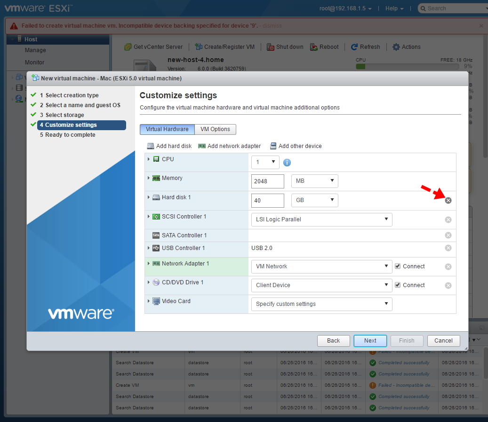
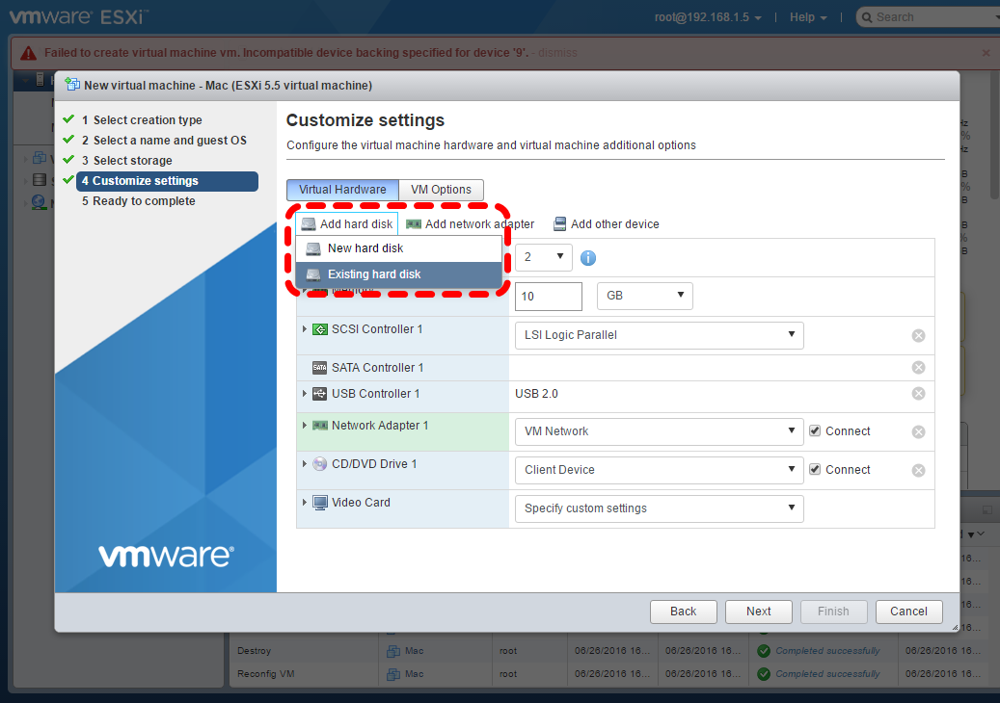
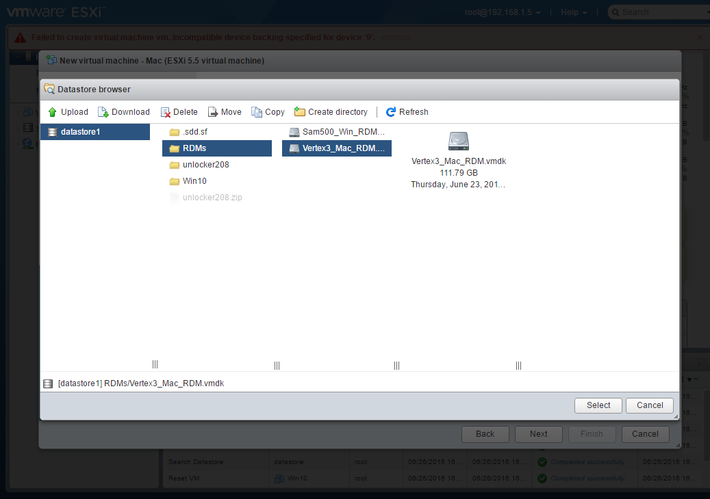
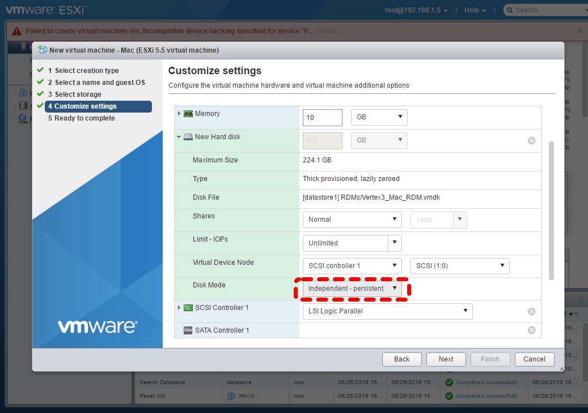
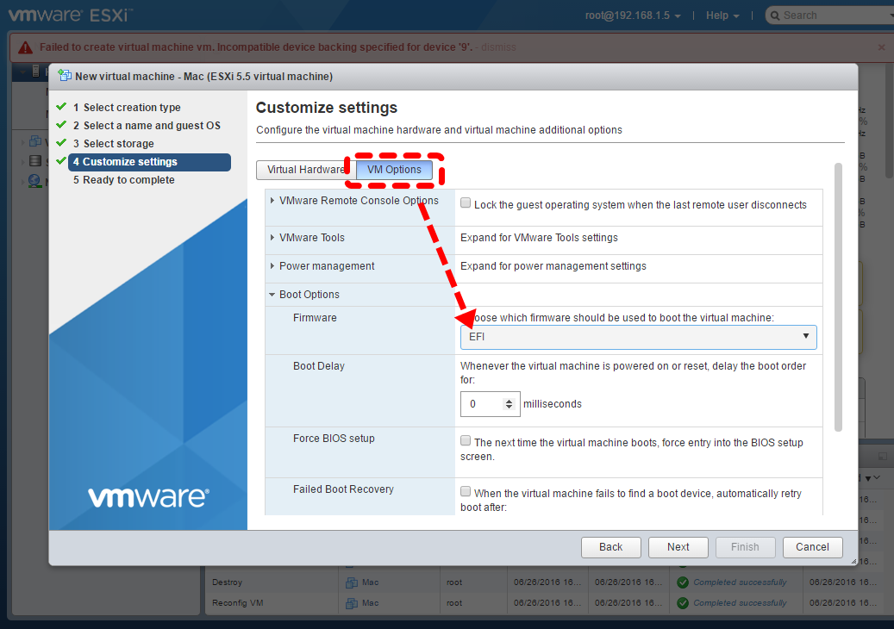
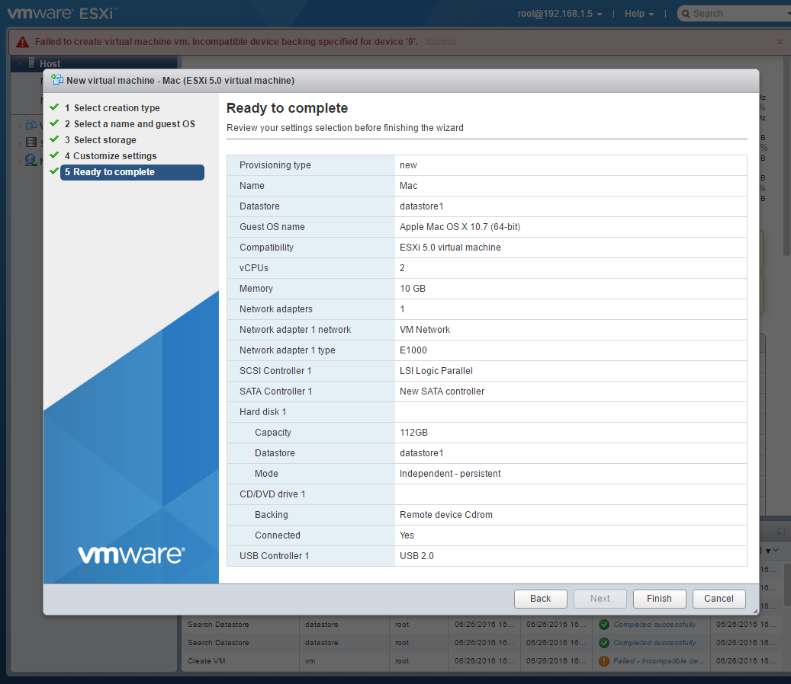
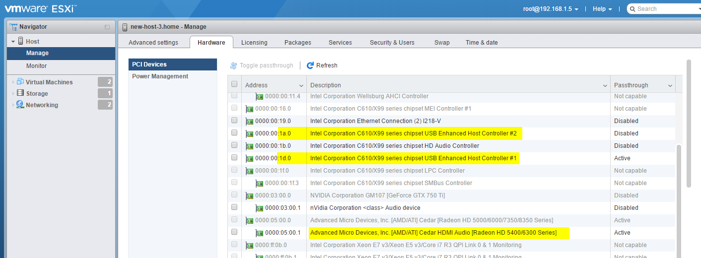
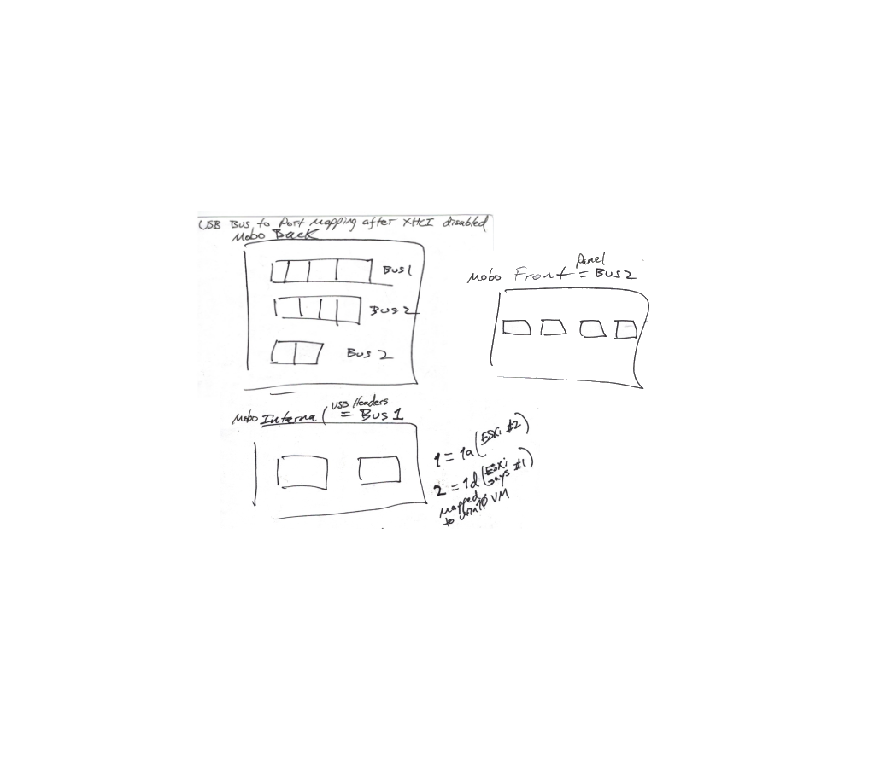

### Video config

* Noteable: VT-d aka IOMMU aka DirectPath I/O aka passthrough provides direct physical connection from VM (i chose Windows) to PCIe devices for GPU and USB which allows for <mark>running the Windows desktop directly on the ESXi box without typical need for a separate machine to remote in from</mark>...
* this does mean once the VM starts up, it completely takes over the graphics card to where the ESXi host is truly "headless"... so i've actually got 2 GPUs running, an old ATI dedicated to the Windows VM and another just for getting into ESXi shell on physical host...
* **NOTE: single GPU configuration is very viable**... all settings (both host and VM) are done through remote clients (see [Which Client?](#which_client) below)... if for some reason that wasn't an option, you could disable VM autostart via vSphere client and thereby leave a lone GPU for troubleshooting directly on the host console after boot up... i suppose if things were ever so horked up that disabling the GPU takeover autostart remotely wasn't an option, then finding another graphics card to throw in might be the only choice... but really any old card would do (i.e. temp borrow someone else's) since it's just a text based linux console.
* reportedly nVidia consumer grade cards like my nVidia GTX 750 Ti are specifically crippled against VT-d... nVidia reserves this for their high end $$ cards... [clever folks are mod'ing low end cards to report VT-d compatible DeviceId's](https://www.eevblog.com/forum/chat/hacking-nvidia-cards-into-their-professional-counterparts/) but i haven't found anyone doing the 750 Ti yet... also wonder about DSDT override approaches... unfortunately Windows doesn't pay attention to bootloader magic ala Clover, otherwise [FakeId](/images/uploads/2016/esxi-for-winmac-xamarin-ios-dev-nirvana-6197d53f4c01.png) would be awesomely too easy... [ESXi does seem to support a custom DSDT](https://communities.vmware.com/thread/494835?start=0&tstart=0) -or- it looks like there's a way to [punch a DSDT into the registry](https://github.com/Microsoft/graphics-driver-samples/wiki/Install-Driver-in-a-Windows-VM) for development purposes
* fortunately ATI doesn't cripple their consumer GPUs... the [5450 was a $30 card circa 2012](/ati-5450-with-hackintosh-lion-107x/) and supports 3 digital displays with completely passive cooling (i'm a sucker for fanless)
* more recently I'm liking the footprint of an HP 2GB ATI 7570 i picked up for $40 used on eBay also with all 3 digital port types, including the elusive DisplayPort... the HP ones with model#'s 672462, 695635, 695633 are nice small half length cards that i can report are an essentially silent fan... keep an eye on the RAM since there's a lot of 1GB ones out there but frankly 1GB probably runs everything fine anyway
* pretty sure could just as well run the Mac on the VT-d GPU and thereby gain full QE/CI accelerated graphics if needed (iMovie being a notable app)... VM'ing OSX with VT-d graphics providing full speed QE/CI is an interesting blend of virtual and physical versus more traditional full physical approach to the hackintosh game... i suppose it still comes down to fiddling with each of your specific I/O devices (Bluetooth, WiFi, Audio, etc)

### HD config

* [this post](https://www.vm-help.com/esx40i/SATA_RDMs.php) details how to create RDM (Raw Device Mapping) vmdk's to <mark>mount our <u>**consumer sata drives**</u> containing existing physical Win and Mac boot installations directly as VMs</mark>, nice! ... Nutshell steps:

    ```shell
    #one time only md /vmfs/volumes/datastore1/RDMs

    #list your disks
    ls -l /dev/disks | grep -i "vml.*[^:][^9] ->"

    #take disk "guid" from above and sub in below
    #and replace .vmdk below with yours
    vmkfstools -r /vmfs/devices/disks/vml.0100000000533231484e5341464335303333354c202020202053616d73756e /vmfs/volumesdatastore1/RDMs/Sam500_Win10_RDM.vmdk
    ```

### Keyboard / Mouse (surprisingly hard)

* basically there's no way to do trivial USB device assignment ala the Workstation products' toolbar buttons... i couldn't believe this initially and went looking for a long while... yet [apparently VMware has specifically prevented mapping USB keyboard/mouse ("HID")](https://communities.vmware.com/thread/466416)... speculatively to prevent losing complete control of your only means of input on the bare host but i haven't run across an official "why" documented in black and white... for the record, [certain enterprise oriented dongles are specifically supported for mapping at individual USB device granularity](https://kb.vmware.com/selfservice/microsites/search.do?language=en_US&cmd=displayKC&externalId=1021345)
* so we must VT-d passthrough a PCIe device corresponding to an entire USB bus vs individual devices...
* modern mobos typically rock multiple USB buses so theoretically we can simply carve one off for VM and leave one for host keyboard... Helpful [Post1](https://www.breekeenbeen.nl/2012/10/03/vmware-esxi-determine-which-usb-bus-to-pass-through/), [Post2](https://www.virten.net/2015/10/usb-3-0-devices-detected-as-usb-2-in-esxi-6-0-and-5-5/)
* but my default mobo config somehow had all the real USB ports clustered on a single hub address even though there were other hubs listed... after some trial & error BIOS fiddling reboots i found that setting XHCI to disabled yielded two separate PCIe entries in the passthrough settings UI like the above posts... that does mean i have no USB 3.0 for high speed transfers, so if that matters to you, it's worth considering a [$15 USB card](https://www.amazon.com/s/ref=sr_st_relevanceblender?keywords=USB+3.0+pcie+card)
* navigate to the passthrough settings UI via: your host > Configuration tab > Hardware section > Advanced Settings

### Network

* <mark>Make sure you use VMXNET3 virtual NIC</mark>
* the Intel E1000 default definitely sucks! it was giving me only 20 mbit downloads on my 30 mbit line
* [special instructions for Mac](https://www.virtuallyghetto.com/2016/10/vmxnet3-driver-now-included-in-mac-os-x-10-11-el-capitan.html) ... i edited my VMX file directly (see [vmx edit](#vmx_edit) tip below)

## Deploying to real iOS device via virtualized Mac USB

* this basically means we gotta dedicate another whole USB bus VT-d to the Mac VM... i can confirm this does indeed work... i'm leaving my Mac VM OUT of auto startup so that one USB bus stays with the host for local keyboard ESXI shell access if i ever need it

<a name="which_client"></a>
## Which Client?

* it's wild how many different clients VMware has cooking... and they all have annoyances... vSphere Client, vCenter Web Client, VMware Remote Console (VMRC), ESXi Embedded Host Client and i hadn't realized VMware Workstation's UI will readily console into remote VMs in addition to its main function
* FYI, if you get an "HCMON" conflict error with any of the installers – just run the installer exe as admin
* **vCenter Web Client** – oft touted as the leading functionality bits (other clients warn of decreased VMware v11 hardware capability) ... <input type="checkbox" class="expander"><mark>but it requires licensed vSphere Server...</mark> <span>...i.e. $ and another Windows Server or Linux box... will NOT install on Windows DESKTOP skus... previous versions we could fairly easily mod the MSI to ignore Server check, but latest v6.5's MSIs are signed and won't run after modded... AppCompat HighVersionLie shim didn't work because it's stuck on NTProductType (1=Desktop, 3=Server) not version and i was too scared to try an old tool like [NTSwitch](https://archive.oreilly.com/pub/a/oreilly//news/differences_nt.html) on my main rig... saving that for rainy day VM excercise</span>
* **VMWare Remote Console** – for quick remote desktop into the Mac i've settled on (rather undoc'd) parms for [VMRC](https://www.virtuallyghetto.com/2014/10/standalone-vmrc-vm-remote-console-re-introduced-in-vsphere-5-5-update-2b.html#comment-41274) `"C:\Program Files (x86)\VMware\VMware Remote Console\vmrc.exe" -H esxi_ip -U userid -P password -M vmid`
  * locate vmid via ESXi Shell: `vim-cmd vmsvc/getallvms`
  * these modern clients seamlessly auto resize the mac desktop resolution just by dragging the console windows handles, nice!... just make sure to bump the paltry default 4MB VRAM via your VM > Edit Settings > Hardware tab > Video card... 64MB seems plenty... this setting supersedes the oft mentioned sVGA.vramsize vmx setting
* **ESXI Embedded Host Web Client** – for admin/settings the [Host Client](https://labs.vmware.com/flings/esxi-embedded-host-client) is nicely capable w/o installing anything... access via: https://esxi_ip_addr/ui/
* **vSphere Client** – for creating and modifying the VM settings, i found the vSphere Client to be more forgiving than the Embedded Host Client which would reject the provisioning submission with an "Incompatible device backing specified for device '9'" error no matter what i tried
  * configure auto-login shortcut with command line params similar but SLIGHTLY DIFFERENT to VMRC: `"C:\Program Files (x86)\VMware\Infrastructure\Virtual Infrastructure Client\Launcher\VpxClient.exe -u user -p password -s ip_address`
  * rats! as of v6.5 release wave, [vSphere Client is officially dropped](https://kb.vmware.com/selfservice/microsites/search.do?language=en_US&cmd=displayKC&externalId=2147929)... last v6.0 revision still forwards compatible with 6.5 servers
* **SSH** – and then [SSH'ing into the ESXi Shell](https://www.thomasmaurer.ch/2011/08/enable-ssh-on-esxi-5-via-vsphere-client/) for any low level commands like the RDM stuff...
  * on Windows, [PuTTY](https://www.chiark.greenend.org.uk/~sgtatham/putty/download.html) provides great shell experience (colors, cursor keys, delete, etc all just work, no fuss, no muss)
    * if you've got the new Ubuntu Linux Subsystem for Windows 10 loaded, that BASH has SSH built in

## Skipping Clover

Sometimes it's handy to physically boot into the Mac... one reason is to get full CG/CI video on a real GPU for something like iMovie... i like Clover for this (EFI mode)... but then it is also in the loop when booting Mac under VMware... problem is, for me **versions of Clover beyond r3265 crash under the VM**... 

TL;DR: Add a new entry to the ESXi EFI BIOS Boot Manager for OSX's /System/Library/CoreServices/boot.efi

<p></p><input type="checkbox" class="expander"><i>The long story...</i>

<div markdown="1">

i've found one way to workaround is to "skip" Clover by configuring a special entry in the VMware EFI BIOS boot selection screen (i.e. the "F2" menu)...

<p></p><input type="checkbox" class="expander"><i>screenshots of all the BIOS screen settings...</i>

<div markdown="1">

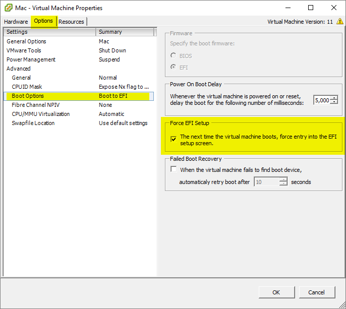
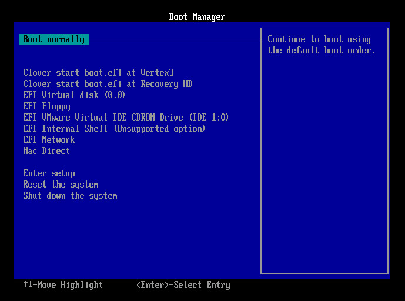
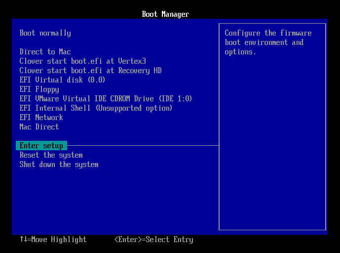

<br/>Loading the HFS driver so we can see the OSX System partition<br/>
<br/>
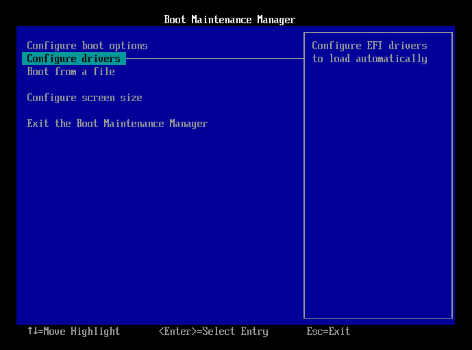
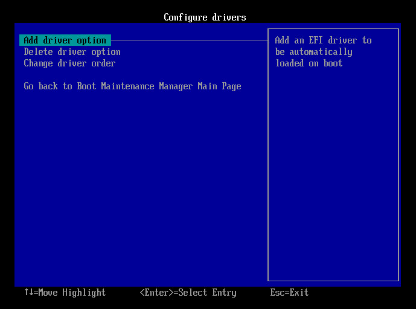
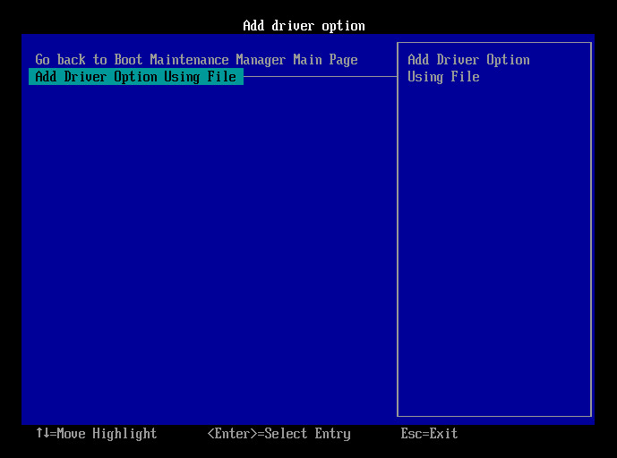
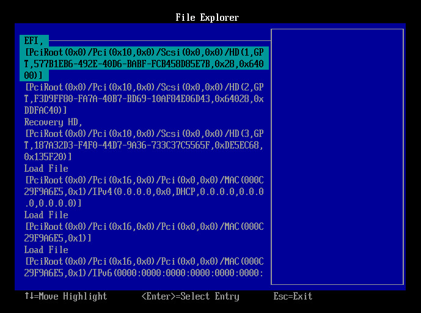
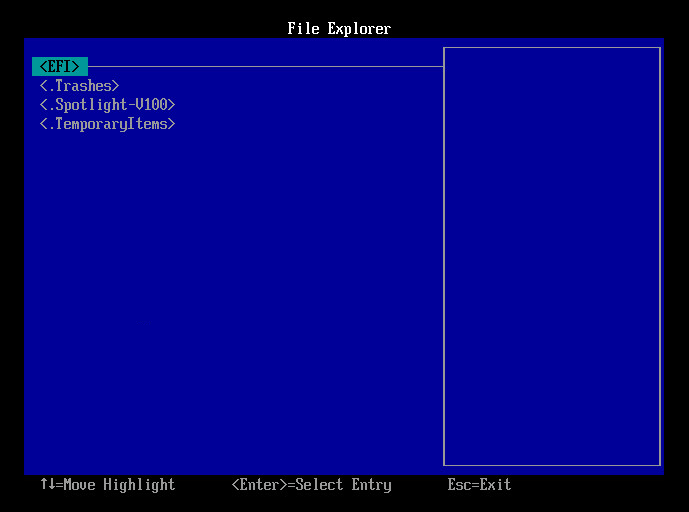
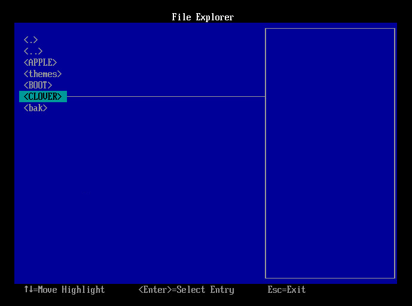
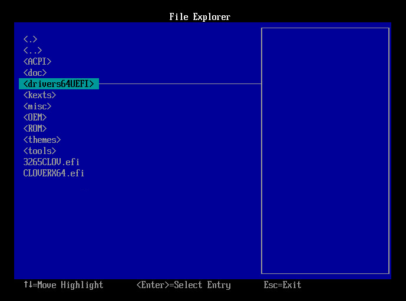
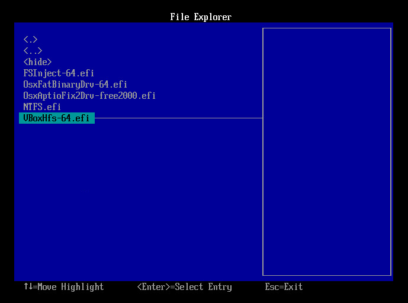
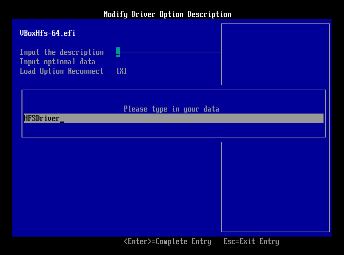
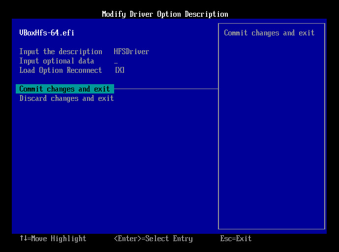<br/>

now hit ESC back up to the top<br/>
Adding the Mac's boot.efi entry 
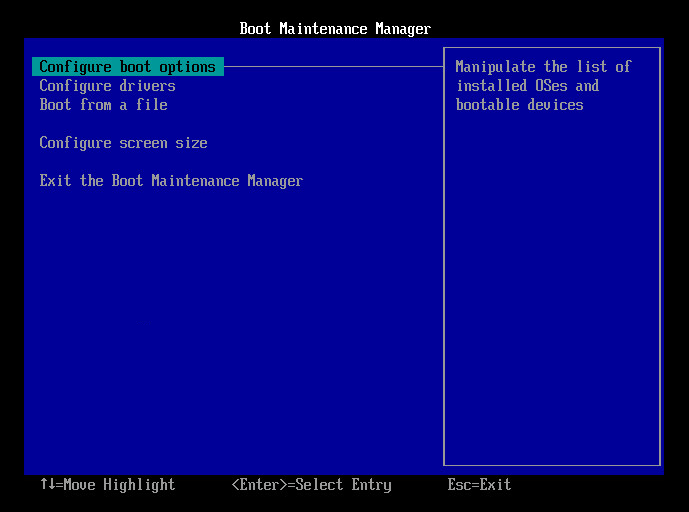
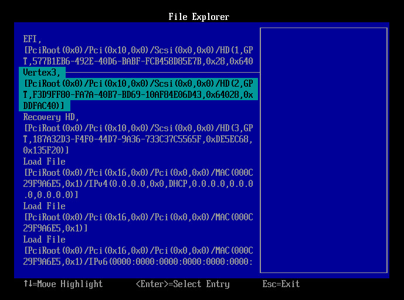
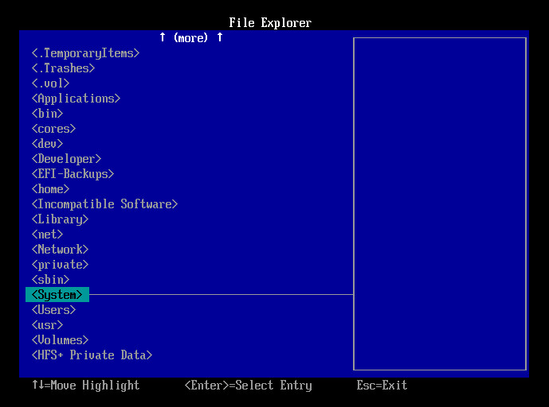
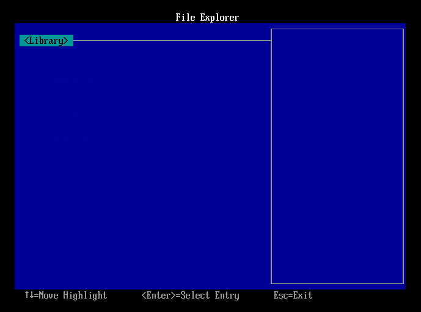
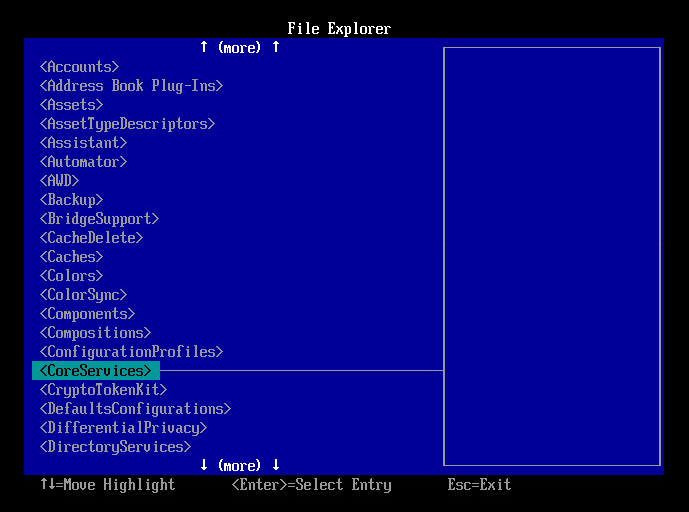
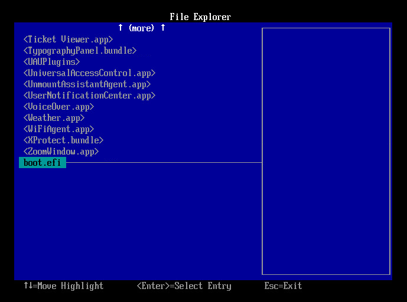
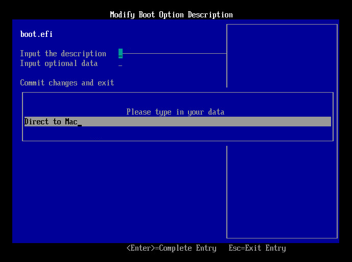
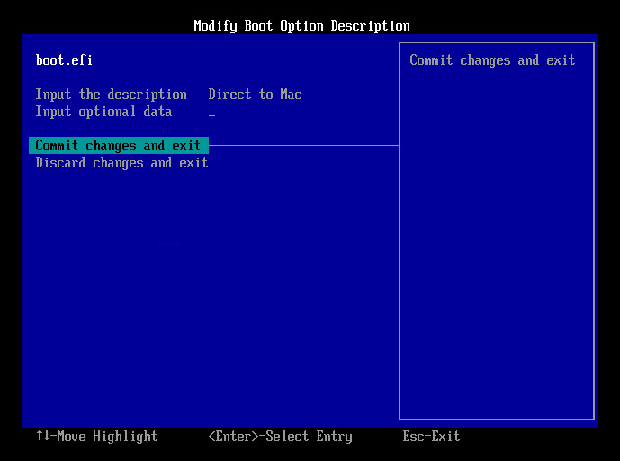<br/>

Change the Boot Order to put it at the top to be the default<br/>
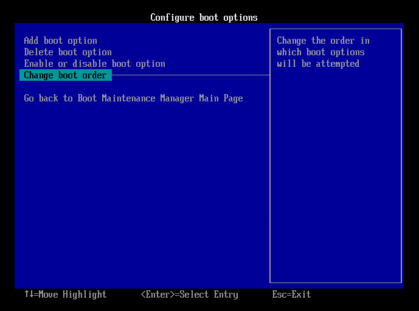
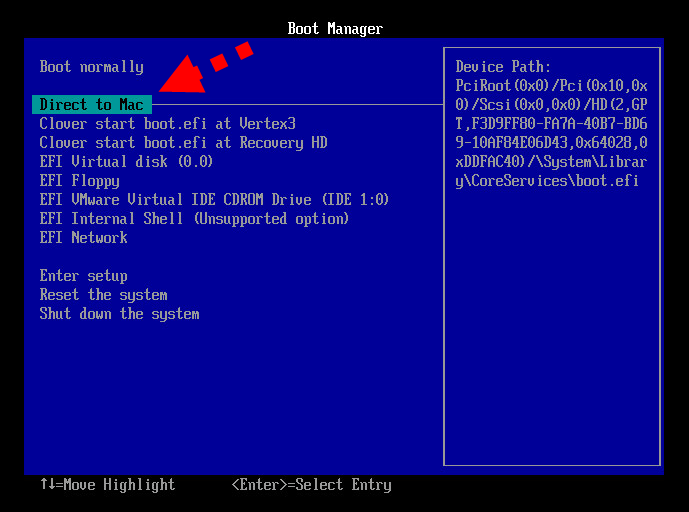<br/>
</div>

<br/>

<p></p><input type="checkbox" class="expander">
### EFI Shell BFCG gone missing???

* i originally worked this out through the EFI Shell prompt via BCFG commands... but retracing my steps bcfg is not present in the shell???... i must've somehow enabled it during experimentation and have no recollection of how... i was doing things like loading \EFI\CLOVER\TOOLS\SHELL64.efi but that didn't seem to do it this time around... would love to hear what i'm missing?? here are those bcfg commands for the record
* we need to load an HFS driver to get to it... on my system the EFI partition where Clover is installed is mapped to FS0:, main OSX partition is FS1:, so:  
* `load fs0:\EFI\CLOVER\drivers64UEFI\VBoxHfs-64.efi`  
* `reconnect -r`  
* ***BCFG*** – the pertinent command for manipulating EFI BIOS menu entries:  
* `help bcfg` is our friend  
* `bcfg boot dump` to list current choices  
* `fs1:`  
* `cd \System\Library\CoreServices`  
* `bcfg boot add 1 boot.efi "Direct to Mac"`  
* if you add this as entry #1 as shown, it'll be selected by default without intervention which is convenient  
* you may want to add in a `bios.bootDelay = "5000"` in your Mac.vmx to give a moment to hit F2 if you find yourself needing to return to this screen often  
* for the google record, the error i run into with Clover beyond r3265 under VMware was *"firmware encountered an unexpected exception"* 
* i've just tried Clover r4061 2017-04-19 and it's still busted => seems the bug is [already reported](https://sourceforge.net/p/cloverefiboot/tickets/354/)...  
* and i indeed have now come to require a more recent Clover release than r3265 under physical Mac ([due to this](https://nickwoodhams.com/x99-hackintosh-osxaptiofixdrv-allocaterelocblock-error-update/))
</div>

<br/>

## Unfiltered Tips

* consider skimming my [Diigo ESXi tag](https://www.diigo.com/user/brentanderson/ESXi) for more helpful posts
* <a name="vmx_edit" style="position: relative"></a>SOME VMX settings can be applied under {your VM} > Edit Settings > Options tab > Advanced > General > Configure Parameters button... but i've found not everything sticks here and i've had to vi the VMX file directly from SSH... `vi /vmfs/volumes/datastore1/{your vm name}/{vm name}.vmx`... then `vim-cmd vmsvc/getallvms` to find your VMID and lastly `vim-cmd vmsvc/reload {VMID}` to activate any changes
* disable "Your Mac OS guest might run unreliably with more than one virtual core" message upon startup... this is bogus advice at this point
  * VMX setting: isolation.tools.bug328986.disable = "TRUE"
* make sure you apply the smc.version = "0" tip in the unlocker notes if creating ESXi 6.0 compatibility level VM's (i.e. "Hardware Version 11")
* Unfortunately after most guest reboots (not all), Win10 falls into an "automated repair" blue screen cycle of doom... i've come to realize that merely deleting and recreating RDM file from CLI is all that's needed... so i created a little script for that in the host's RDM folder and SSH in to execute it whenever things go south  
  ```
  rm Sam500_Win10_RDM*.vmdk  
  vmkfstools -r /vmfs/devices/disks/vml.0100000000533231484e5341464335303333354c202020202053616d73756e Sam500_Win10_RDM.vmdk  
  ```
* Virtual Machine Startup/Shutdown needs to be configured for convenient auto booting of VMs when host spins up... UI is unintuitive, make sure to bump VM up into the Automatic Startup section
* i started on GA-X99-UD4 BIOS rev.F12 ... at first everything was copacetic but wound up at pitch black UEFI BIOS screens after reboot (monitor lights on so live signal, but no UI)... i found that taking either GPU out before boot would actually work so it was a dual GPU issue... up'ing to BIOS rev.F22 permanently resolved that
* if you're looking to jump in with turnkey hardware: this [TinkerTry](https://tinkertry.com/superservers) guy really looks to have done all the homework... 8 core XEON (D-1541 = 2.1GHz, BGA mounted = no upgrades possible), 64GB RAM in a cute little mini-tower case, 100% VMware official compatible components, all tested out and ready to rock as a local VT-d workstation just like what i've shown here
* **Cross Platform Clipboard** – tried several, [free Share Clipboard via node](https://github.com/coralw/share-clipboard), CopyCopy, CrossClip, Alt-C, etc... FINALLY! [NoMachine](https://www.nomachine.com/) to the rescue = free modern cross platform remote desktop with **working clipboard**, yay!! bonus points: it also enables sound in the remote Mac window... VMware doesn't have any solution for that yet... the window drag looks a little pokey vs VMRC but definitely usable.
